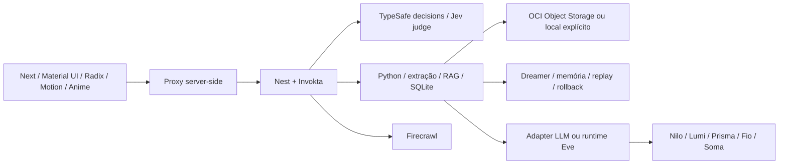

# NovaMente Atlas

Uma biblioteca que pensa com você: documentos técnicos viram materiais citáveis, tutoria e prática. Kickoff do projeto ONE G10, Oracle + Alura.

**Especificação consolidada:** [docs/SPEC.md](docs/SPEC.md). **Estado real e limites:** [docs/STATUS.md](docs/STATUS.md). **APIs e fornecedores verificados:** [docs/research/integrations.md](docs/research/integrations.md).

## Executar localmente

Requisitos: Linux AMD64, Node 24, npm 11, Python 3.12 e `venv`. As três aplicações são processos separados. Nenhuma chave remota é necessária para experimentar extração e fontes; isso não valida geração LLM nem conclui os critérios de IA/OCI do hackathon.

```bash
bash scripts/setup.sh
npm run dev
```

Abra a porta 3000 no seu ambiente local. O script inicia Next em 3000, Nest em 4000 e Python em 8000, todos em loopback. Ctrl+C encerra somente os processos iniciados por esse script. A interface traz um documento de exemplo identificado como amostra da equipe. Faça upload de PDF textual, Markdown ou TXT UTF-8 de até 10 MiB, escolha objetivo/perfil/formato e gere o material. Fontes e pacotes persistem em `data/`.

O setup preserva `.env` existente e cria um token interno aleatório se necessário. Complete somente as integrações desejadas; veja comentários no [.env.example](.env.example). Nenhuma chave vai para o bundle web. O ambiente ainda não inclui autenticação pública: não exponha a porta diretamente à Internet.

## Arquitetura



Os cinco brains decidem sobre fontes/memória autorizadas e invocam três Action Engines Invokta versionadas: aprendizagem, pesquisa e memória/Dreamer. Contratos e permissões estão em [docs/architecture/brains-and-action-engines.md](docs/architecture/brains-and-action-engines.md). Invokta executa ações com schemas no Nest. Eve possui agente raiz e quatro especialistas em `apps/api/agent`; é um runtime separado, ativado quando houver modelo/credenciais. Sem runtime/chave, os traces mostram o pipeline determinístico, não conversas simuladas de modelos. O runtime Eve usa um filesystem virtual JS sem processos nativos; ferramentas padrão de shell/arquivos ficam desativadas. A API Python publica seu OpenAPI na porta interna 8000 em `/docs`.

RAG oferece vetor puro, híbrido FTS+vetor e documento integral dentro do orçamento. Sem chave de embeddings usa hashing lexical de demonstração; não equivale a embeddings semânticos. O adapter remoto usa o formato OpenAI `/embeddings` ou `/chat/completions` quando explicitamente configurado. A compatibilidade SubQ Snap ainda depende de documentação primária; não há URL/modelo adivinhado. Ao habilitar ou trocar embeddings, pare os serviços e execute `bash scripts/reindex.sh`; IDs de fonte/citação permanecem estáveis, e falha no provedor preserva o índice anterior.

## Dreamer é parte do núcleo

O painel Memória & Dreamer permite consentir, observar ciclos, reverter uma política e apagar memórias. O serviço Python mantém eventos por workspace; sem consentimento não coleta experiências para melhoria. Com consentimento e geração+Typesafe configurados, propõe uma política pedagógica restrita a enums, compara baseline/candidato em três casos com citações, exige suporte e melhora sem regressão, promove a versão ou rejeita. O próximo material usa a política ativa. Um replay remoto por dia/workspace; agendamento horário configurável. Alterações de código, segurança ou permissões são proibidas.

Sem chaves, ciclos retornam `awaiting_evaluation`; não fingem aprendizado validado. Testes controlados verificam promoção/rollback/exclusão, mas não provam eficácia pedagógica em pessoas. Memória coletiva exige identidade, opt-in e agregação e continua como etapa do produto antes de liberação pública.

Para separar infraestrutura, `MEMORY_SERVICE_URL` aponta a instância do mesmo serviço de memória por HTTPS, com `MEMORY_SERVICE_TOKEN`; a instância externa usa `ATLAS_SEED_DEMO=0`, `ATLAS_INTERNAL_TOKEN` igual ao token do serviço e suas próprias credenciais server-side. Nessa instância que guarda a memória, deixe `MEMORY_SERVICE_URL` vazio para evitar encaminhamento recursivo. Experiências e casos de replay só seguem após consentimento, por `/v1/dreamer/experiences`; a política volta pelo contrato de status. Configure o `ATLAS_API_URL` dessa instância para o Nest acessível por rede privada/TLS para o judge. Não há VM/Railway provisionada nem teste externo realizado neste kickoff.

## Integrar provedores

| Integração | Configuração | Prova necessária |
| --- | --- | --- |
| TypeSafe/Jev | `TYPESAFE_API_KEY` | Decisão e veredito reais, calibrados com avaliação humana |
| LLM | `LLM_BASE_URL`, `LLM_MODEL`, `LLM_API_KEY` | JSON e citações válidas para 2 perfis/2 formatos |
| Embeddings | `EMBEDDING_BASE_URL`, `EMBEDDING_MODEL`, `EMBEDDING_API_KEY` | Reindexação e recuperação semântica |
| Firecrawl | `FIRECRAWL_API_KEY` | Pesquisa autenticada; ferramenta Eve → Invokta |
| OCI | `STORAGE_PROVIDER=oci`, namespace/bucket e instance principal ou perfil externo | Upload e readback de original+JSON |
| Eve | `EVE_MODEL`, `AI_GATEWAY_API_KEY`, runtime em `EVE_URL` | Build/runtime e turno real |

Com as chaves de Eve configuradas, compile e inicie separadamente:

```bash
bash scripts/eve.sh build
bash scripts/eve.sh start
```

O script carrega `.env`; o runtime exige `EVE_MODEL` explícito e não seleciona um modelo pago silenciosamente. A compilação local foi verificada com `EVE_MODEL=openai/gpt-5.4-mini`, usando apenas metadados já embutidos no SDK; isso não valida inferência nem escolhe o modelo final do produto. Defina `EVE_URL` no restante do app somente depois de o runtime estar pronto. O canal Eve exige Bearer `EVE_SERVICE_TOKEN`, com fallback ao token interno local. Para outra máquina, use token próprio, TLS/rede privada e limites de runtime separados. Não presumimos SubQ no AI Gateway.

## Verificações

```bash
npm test
npm run typecheck
npm run build
# Com npm run dev ativo:
npm run smoke
npm run test:proxy -w @atlas/web
```

O smoke cria um documento, grupo/mensagem e material de teste no workspace local e testa XP idempotente. Os testes Python usam diretórios temporários. Os testes de provedores são controlados; chamadas reais permanecem pendentes de credenciais. Capturas locais da UI estão em `apps/web/artifacts/` (outputs ignorados no Git).

## Oracle e orçamento

Compose em [compose.yaml](compose.yaml) limita web a 768MiB, Nest a 512MiB e Python a 1536MiB: 2816MiB em limites de containers, deixando margem no alvo de 6GB. Eve pode rodar sob demanda ou fora da VM; o limite do core não mede o runtime adicional. Imagens devem ser construídas em CI e publicadas no registry do projeto antes do deploy. O compose só expõe 3000 em loopback; não é uma autorização de deploy público.

```bash
docker compose build
docker compose up -d --wait --wait-timeout 90
# Finalizar sem apagar dados:
docker compose down
```

O BuildKit usa a CA pública do host como secret de build para validar TLS atrás do proxy deste ambiente; em outro host, ajuste `ATLAS_BUILD_CA_BUNDLE` se necessário. Não desabilitamos verificação TLS nem copiamos certificados de credenciais para a imagem.

Confirmar SKU, região, conta, cotas e cobrança: AMD com 6GB não é automaticamente Always Free. Não há recurso Oracle criado neste kickoff. Nunca versionar `.oci/config`, PEM ou `.env`; priorizar instance principal e IAM de mínimo privilégio no bucket privado. Análise de custo e teste no hardware-alvo são gates da entrega.
