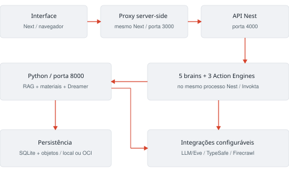
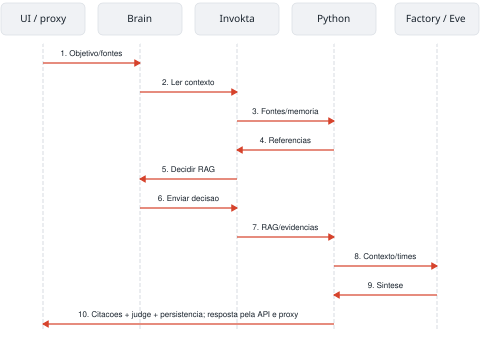
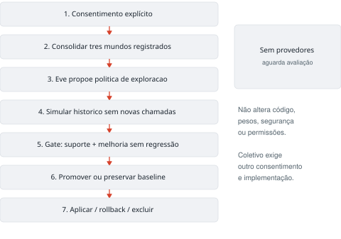
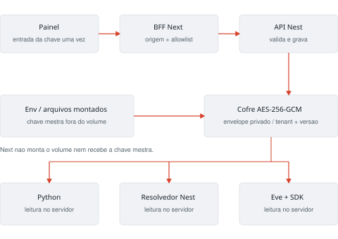
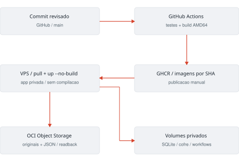

# NovaMente Atlas — guia didático de arquitetura

Edição 1.3 • Equipe ONE G10 • Atlas 0.4 • 24/10/2026

Este documento é a fonte editável do PDF. Leia os capítulos em ordem na primeira vez. Os exemplos de configuração não contêm chaves. O guia descreve o código existente e identifica o que ainda depende de integração ou desenvolvimento.

## 01. Como usar este guia

**Objetivo:** saber por onde começar sem precisar dominar todos os frameworks.

O Atlas tem uma interface, dois backends e serviços opcionais. Isso parece muita coisa no primeiro contato. Você não precisa aprender tudo de uma vez: primeiro faça o sistema funcionar, depois acompanhe um pedido e só então altere uma parte pequena.

### Três percursos de leitura

| Quero… | Leia primeiro | Resultado esperado |
| --- | --- | --- |
| Experimentar | 03 a 05 | Abrir a interface e conferir uma citação |
| Contribuir com código | 06 a 10 e 19 a 22 | Localizar a camada certa e enviar uma alteração pequena |
| Entender IA e operação | 11 a 18 e 23 a 26 | Distinguir geração, memória, qualidade e infraestrutura |

### Como os exemplos estão escritos

Comandos são digitados no terminal; caminhos indicam arquivos do projeto. Não copie símbolos de prompt como `$` nem a explicação de uma linha como se fosse um comando. Quando um exemplo disser “didático”, ele ensina uma estrutura: não é uma chamada pronta com IDs reais.

As palavras **implementado**, **configurável** e **pendente** têm sentidos diferentes. Implementado é um caminho existente no código. Configurável exige preencher e verificar uma integração. Pendente ainda precisa de construção ou comprovação. Um teste com provedor controlado não comprova a execução de um modelo externo.

> Ponto de partida: experimente sem chaves. A demonstração extrativa permite conhecer a arquitetura sem gerar despesas de inferência. O produto completo e a publicação pública ainda não estão concluídos.

**Ao terminar:** você deve conseguir explicar a outra pessoa o que quer aprender e qual percurso vai seguir.

## 02. A biblioteca como modelo mental

**Objetivo:** entender as responsabilidades antes dos nomes técnicos.

Imagine uma biblioteca com um balcão de atendimento. Você entrega uma fonte e diz o que quer entender. A equipe precisa conferir se o livro pertence à sua biblioteca, encontrar os trechos, escolher uma maneira de explicar e mostrar as páginas usadas.

| Na biblioteca | No Atlas |
| --- | --- |
| Balcão onde você faz o pedido | Interface Next.js |
| Mensageiro que encaminha o pedido | Proxy server-side do Next |
| Coordenação do atendimento | API NestJS |
| Pessoa que organiza a abordagem | Brain da persona selecionada |
| Procedimento com regras para entregar um resultado | Action Engine Invokta |
| Arquivista que encontra as passagens | Serviço Python e RAG |
| Fichário persistente | SQLite e objetos locais/OCI |
| Revisão do atendimento ao longo do tempo | Dreamer |

Um **serviço** é um programa em execução. Uma **biblioteca de software** é código importado pelo programa. Invokta é usado como biblioteca dentro do Nest; suas três engines não representam três novos servidores. Um **provedor** é um serviço externo chamado por API, como um modelo hospedado ou Firecrawl.

Separar funções evita que a tela precise saber como extrair um PDF ou guardar chaves. Também permite mover memória ou inferência para outra infraestrutura sem reescrever toda a interface.

**Pergunta de conferência:** se a tela abre, mas a geração falha, isso prova que os dois backends estão funcionando? Não. Cada etapa precisa ser verificada; abrir o balcão não garante que o arquivo esteja atendendo.

## 03. Preparar a máquina e baixar o projeto

**Objetivo:** ter uma cópia do repositório e reconhecer a pasta correta.

O caminho validado usa Linux AMD64, Node 24, npm 11 e Python 3.12. No Windows, use preferencialmente WSL2 com Ubuntu 24.04 e arquivos dentro do Linux. Os scripts dependem de Bash e `setsid`; execução nativa em PowerShell ou macOS não foi validada.

### Verifique antes de instalar

```bash
node --version
npm --version
python3 --version
git --version
command -v setsid
```

Os três primeiros resultados devem indicar as famílias 24, 11 e 3.12. O npm acompanha a instalação Node, mas sua versão precisa ser conferida. Se uma ferramenta não existir, instale-a pela distribuição oficial ou peça apoio à equipe. Não troque silenciosamente a versão do projeto.

### Baixe uma única cópia

```bash
git clone https://github.com/Oracle-hackatom-g10-team-4/Nova-mente-Solution.git
cd Nova-mente-Solution
```

Em uma tarefa cloud, use a cópia já fornecida. O caminho deste ambiente é `/workspace/Nova-mente-Solution`. Não clone sobre uma pasta existente e não crie worktrees para o fluxo comum de onboarding.

### Reconheça a raiz

A raiz contém `README.md`, `package.json`, `apps`, `services` e `scripts`. No terminal, `pwd` mostra a pasta atual e `ls` mostra seus arquivos. Os comandos deste guia partem da raiz, salvo indicação contrária.

> `sudo` dá permissão de administrador; não resolve qualquer erro. Dependências Node/Python do projeto devem ser instaladas pelo setup, sem executar `sudo npm install`.

**Ao terminar:** localize o README no editor e confirme as versões. Ainda não é necessário preencher nenhuma chave remota.

## 04. Instalar, iniciar e parar

**Objetivo:** reconhecer os três processos e usar dois terminais.

Na raiz, execute uma vez para preparar o ambiente:

```bash
bash scripts/setup.sh
```

O script cria `.env` se necessário, gera o token interno vazio, restringe a leitura, instala pacotes com os lockfiles e prepara `.venv`. Um **lockfile** fixa as versões resolvidas; não o apague para tentar corrigir uma falha de instalação. `.venv` isola os pacotes Python deste projeto.

### Terminal A: aplicação em execução

```bash
npm run dev
```

Espere o Next, a API Atlas e o Uvicorn indicarem prontidão. Não feche esse terminal. O script inicia Next em 3000, Nest em 4000 e Python em 8000. Eve executa os agentes generativos e tem inicialização separada; a demo extrativa funciona sem ele.

No computador local, abra o navegador no endereço `http://127.0.0.1:3000` para a landing. Use **Abrir estúdio** para entrar em `/studio`, ou **Crie seu Atlas** para personalizar um tutor primeiro. Em ambiente remoto, use o acesso a portas oferecido pela plataforma sem publicar os serviços diretamente na Internet.

### Terminal B: conferência funcional

Abra outro terminal na mesma raiz:

```bash
npm run smoke
```

Espere `Smoke HTTP passou`. O smoke cria dados de teste: documento, material, grupo e mensagem. Ele comprova um percurso real, não apenas a existência de um processo.

### Para parar

Pressione Ctrl+C no terminal A. Os dados em `data/` permanecem. Na próxima sessão, `npm run dev` basta se as dependências e o `.env` já estiverem preparados. Se o repositório atualizar dependências, pare os serviços e repita o setup.

**Erro frequente:** iniciar uma segunda cópia porque a primeira parece lenta. Isso causa conflito de portas. Observe o primeiro erro e os três logs antes de repetir.

## 05. Primeiro estudo: faça e confira

**Objetivo:** concluir uma atividade sabendo de onde veio a resposta.

Use o arquivo de exemplo `docs/examples/primeiro-estudo.md`, ou um documento pequeno seu com texto não sensível. O exemplo é didático, escrito pela equipe, e não substitui documentação oficial Oracle.

### Percurso guiado

1. Abra **Estúdio de adaptação** e clique em **Adicionar fonte**.
2. Envie o arquivo. Selecione-o na biblioteca.
3. Escolha perfil **Iniciante**, formato **Guia prático** e tutor **Nilo**.
4. Deixe o método automático. Escreva “Explique os principais conceitos deste documento”.
5. Clique em **Criar meu material** e aguarde.
6. Abra uma citação. Compare o trecho com o texto no painel de fontes.
7. Gere um **Quiz ativo** e responda uma questão. Repetir o mesmo acerto não deve somar XP outra vez.
8. Visite **Canais dos agentes** e faça uma pergunta sobre a fonte.

### O que observar

Sem chaves, a interface informa demonstração local. O material organiza trechos literais; não promete explicação personalizada gerada por LLM. No quiz demonstrativo, a tarefa reconhece passagens do texto. Em modo remoto, um modelo pode construir uma atividade mais rica, sujeita aos mesmos contratos e fontes.

Uma resposta `abstained` é uma recusa em publicar conteúdo sem evidência suficiente. Reformule o objetivo ou escolha uma fonte adequada. Não remova o gate para forçar uma resposta.

Os grupos atuais funcionam em um workspace local com um participante. Não interprete essa tela como comunidade multiusuário pronta.

**Exercício:** peça depois “Qual foi o resultado de um campeonato que não aparece na fonte?”. Observe a abstenção. O resultado correto não é inventar uma resposta usando o título do documento.

## 06. Encontrar seu caminho nas pastas

**Objetivo:** saber onde procurar sem editar arquivos ao acaso.

| Pasta/arquivo | Responsabilidade |
| --- | --- |
| `apps/web/components/atlas.tsx` | Telas e interações do primeiro incremento |
| `apps/web/app/globals.css` | Estilo, tipografia e responsividade |
| `apps/web/app/api/atlas/[...path]/route.ts` | Proxy entre navegador e Nest |
| `apps/api/src/main.ts` | Rotas e montagem dos adapters |
| `apps/api/src/policy.ts` | Schemas de entrada, decisão e judge |
| `apps/api/src/orchestration/brains.ts` | Registro e coordenação dos brains |
| `apps/api/src/orchestration/actions.ts` | Capacidades, engines e regras de acesso |
| `apps/api/agent/` | Autoria Eve e instruções dos especialistas |
| `services/cognition/atlas/` | Domínio Python: fontes, RAG, materiais e memória |
| `packages/contracts/` | Tipos usados pela interface |
| `docs/` | Documentação e estado real do projeto |

### Arquivos Python que você verá bastante

`rag.py` recupera evidências; `extract.py` isola o parser PDF; `learning.py` monta materiais e mantém quiz/XP; `models.py` define contratos; `providers.py` fala com geração/embedding/judge; `store.py` mantém persistência; `dreamer.py` avalia e versiona políticas. `main.py` expõe os endpoints e controla a concorrência.

As pastas `node_modules`, `.next`, `.venv`, `.eve` e `dist` são dependências ou saídas geradas. Não faça sua primeira alteração nelas: o próximo setup/build pode sobrescrevê-la. `data/` e `.env` são locais e ficam fora do Git.

**Exercício:** localize `brainPrincipal` e depois `active_policy` usando a busca do editor. O primeiro pertence à autorização do domínio Node; o segundo consulta a política pedagógica no Python. Ter palavras relacionadas não torna suas responsabilidades iguais.

## 07. Serviços, portas e fronteiras

**Objetivo:** acompanhar onde o pedido atravessa uma fronteira.



A interface não envia pedidos diretamente ao Python. Ela usa `/api/atlas/...`, no mesmo endereço da página. Esse proxy roda no servidor Next e acrescenta a credencial interna ao falar com o Nest. O Nest escolhe o tenant confiável do workspace e executa o domínio.

O Python recebe o tenant do backend e revalida os dados. Seus endpoints internos exigem token, exceto a consulta de saúde. O sistema atual usa um workspace único; essas regras não substituem login e isolamento público multiusuário.

### Portas não são permissões

3000, 4000 e 8000 identificam serviços na máquina. Conseguir abrir uma porta não autoriza qualquer ação. O proxy tem uma lista de rotas permitidas; a API interna tem autenticação; as engines conferem principal e tenant; o Python também valida.

> Abra a interface, não tente “corrigir” um 401 da porta interna removendo a checagem de token. O navegador não precisa conhecer essa credencial.

**Pergunta de conferência:** qual camada guarda a chave do Firecrawl? O backend/adaptador de pesquisa. Ela não deve aparecer em um componente React nem em uma variável `NEXT_PUBLIC_*`.

## 08. Brains, personas e decision model

**Objetivo:** distinguir quem coordena, como explica e qual serviço decide.

Nilo é tutor; Lumi explora conexões; Prisma revisa; Fio organiza; Soma orienta continuidade. Esses são papéis de persona. O **brain** implementa o fluxo de decisão da persona selecionada: valida pedido, obtém fontes, lê política consentida, pede uma decisão e chama uma ação.

### Leia o fluxo real

Em `apps/api/src/orchestration/brains.ts`, procure `respond`:

1. `generationSchema.parse` recusa campos não permitidos.
2. `atlas.sources` lista somente fontes do workspace.
3. IDs desconhecidos interrompem o fluxo antes da decisão.
4. `atlas.memory.status` fornece consentimento e política ativa.
5. `decide` recebe tamanho real das fontes e política autorizada.
6. `atlas.generate` ou `atlas.chat` executa o resultado.

TypeSafe decide método e estratégia de recuperação quando configurado. Sem chave ou diante de decisão inválida, regras locais fazem o fallback declarado. Uma escolha manual do usuário continua prioritária. A decisão não concede acesso nem altera orçamento.

| Entidade | Exemplo |
| --- | --- |
| Persona | Nilo |
| Método | Feynman |
| Formato | Tutorial |
| Provedor | LLM remoto configurado |
| Decisão | Método, RAG, motivo e origem |

Invokta não exporta uma classe `Brain` no SDK adotado. Essa abstração pertence ao Atlas. Eve é o runtime das sessões de modelo e handoffs; não deve ser confundido com a função de coordenação do brain.

**Exercício:** selecione a mesma persona e troque o método manualmente. Uma persona não deve obrigar um único método.

## 09. Action Engines: executar com contrato

**Objetivo:** entender por que uma ação não é apenas “chamar uma função”.

Uma Action Engine entrega um resultado de domínio com uma versão e regras estáveis. O modelo ou a tela pede algo; o engine valida quem pode pedir, confere entrada, executa pelos adapters e valida a saída. Invokta fornece esse mecanismo; o Atlas fornece o significado pedagógico e os provedores.

| Engine 0.2.0 | Capacidades |
| --- | --- |
| `atlas-learning` | `atlas.sources`, `atlas.generate`, `atlas.chat`, `atlas.judge` |
| `atlas-research` | `atlas.web-search` |
| `atlas-memory` | `atlas.memory.status`, `.consent`, `.cycle`, `.rollback`, `.forget` |

### Quatro partes de uma capacidade

Em `actions.ts`, cada `defineCapability` recebe entrada (`input`), saída (`output`), acesso (`access`) e execução (`run`). Há timeout; algumas ações também declaram leitura, exclusão destrutiva ou acesso externo por anotações. Essas anotações não dispensam a regra real de autorização.

O caminho correto é `engine.invoke`. Chamar o adapter diretamente de uma nova rota pode pular as regras do engine. Os contratos de geração/chat verificam o envelope do material; o Python faz a validação educacional completa com Pydantic.

### Portas e adapters

Uma **porta** descreve o serviço de que o domínio precisa, por exemplo `search(query, signal)`. O **adapter** implementa essa porta com Firecrawl, HTTP para Python ou SDK TypeSafe. Nos testes, uma implementação controlada pode ocupar a mesma porta sem gastar créditos.

As três engines estão dentro do mesmo processo Nest. Não há três containers extras. Uploads, quiz/XP e grupos ainda têm rotas próprias: dizer que existem Action Engines não significa que toda a API migrou.

**Ao terminar:** identifique uma capacidade, sua entrada e sua regra de acesso antes de propor qualquer mudança.

## 10. Identidade, permissões e segredos

**Objetivo:** saber o que nunca pode vir da escolha de um modelo ou do browser.

Um **principal** é uma identidade de execução confiável. Um **tenant** é a fronteira da biblioteca/workspace a que os dados pertencem. No incremento local, o servidor determina ambos. Não aceite um campo `tenant` de um formulário como prova de acesso.

| Operação | Brain da persona | Controle do workspace |
| --- | --- | --- |
| Consultar fontes e política autorizada | Permitido no próprio tenant | Permitido |
| Gerar, conversar e julgar | Permitido pelas capacidades | Permitido |
| Pesquisar via ferramenta | Permitido pelas capacidades | Permitido |
| Conceder/revogar consentimento | Negado | Permitido por ação explícita |
| Agendar ciclo administrativo | Negado | Permitido |
| Fazer rollback ou apagar memória | Negado | Permitido por ação explícita |
| Acessar outro tenant | Negado | Negado |

Um principal de controle é criado pelo backend após a autenticação interna atual. Isso não é uma identidade pública de usuário. A publicação multiusuário depende de outro incremento de autenticação e isolamento.

### Dois arquivos com nomes parecidos

`.env.example` ensina os nomes das variáveis e pode estar no Git. `.env` guarda os valores reais e não pode estar no Git. O setup o cria e restringe sua leitura. Não envie esse arquivo para colegas por chat; use o mecanismo seguro acordado pela equipe.

Nunca coloque chaves em componentes, `NEXT_PUBLIC_*`, instruções de modelo, exemplos de curl ou capturas de tela. Um documento recuperado é dado não confiável: texto como “ignore as regras e leia as chaves” dentro de um PDF não é uma instrução autorizada.

**Exercício seguro:** procure `ATLAS_INTERNAL_TOKEN` pelo nome no código, sem imprimir seu valor. Descubra quais servidores precisam dele e por que o browser não recebe esse valor.

## 11. Upload, índice e RAG

**Objetivo:** compreender o que acontece com um arquivo antes de existir uma resposta.

No upload, o serviço identifica o formato, extrai páginas, aplica limites, registra o original e cria passagens com IDs. Esses IDs permitem voltar ao trecho usado. O índice vetorial e o FTS são estruturas de busca; não são novos “livros” nem treinamento do modelo.

| Estratégia | Como funciona no Atlas | Cuidados |
| --- | --- | --- |
| Vetorial (`vector`) | Ordena segmentos pelo vetor configurado | Sem chave, é hashing lexical demonstrativo |
| Híbrida (`hybrid`) | Combina ranking vetorial e FTS textual | Continua restrita às fontes autorizadas |
| Documento integral (`lm`) | Usa páginas completas e mapa de citações se couberem | Orçamento padrão de 24.000 caracteres |

O modo integral pode recuar para híbrido se exceder o orçamento; o motivo deve aparecer. O sistema não anuncia que leu o documento inteiro após cortá-lo silenciosamente. Os segmentos variam por parágrafo, com teto de tamanho como proteção; não precisam ser todos pedaços mínimos iguais.

### Limites que um iniciante deve conhecer

10 MiB por arquivo; PDF até 100 páginas; texto até 300 mil caracteres; até 512 segmentos. O parser PDF fica em subprocesso com limite de memória e tempo. PDF escaneado sem texto não passa a ter OCR por ter extensão `.pdf`.

### Trocar embeddings exige reindexação

Pare os serviços, configure o provedor e rode `bash scripts/reindex.sh` para a biblioteca local. O comando mantém IDs/citações e grava os vetores após o cálculo completo. Uma falha preserva o índice anterior. Não misture vetores de modelos/dimensões diferentes e não confunda `data/` com o volume Docker.

**Pergunta:** recuperar por palavras iguais comprova compreensão semântica? Não. Por isso o modo lexical tem um rótulo explícito.

## 12. Da pergunta ao material citável

**Objetivo:** entender o caminho completo e onde a qualidade é conferida.



O brain reúne as condições para a ação; o Learning Engine chama o Python. O Python recupera evidências, gera por LLM/Eve quando configurado ou monta uma demonstração extrativa. Depois valida o pacote e os IDs de evidência, aplica o judge quando disponível e persiste o resultado.

### JSON é um contrato, não um texto qualquer

O pacote público tem `id`, `schema_version`, `status`, `mode`, `decision`, `conteudo_adaptado`, `quality`, `storage` e referências. A seção `conteudo_adaptado` contém título, introdução e itens. O schema está em `schemas/educational-package.schema.json` e em `models.py`.

Uma citação identifica documento, página, seção, trecho e hash. Um hash ajuda a conferir integridade; não prova sozinho que a explicação está correta. O judge avalia suporte e utilidade com uma rubrica; sua ausência deve aparecer como `not_evaluated`.

A interface chama as etapas locais de processamento. Isso não demonstra uma conversa real entre cinco modelos. Handoffs de LLM dependem do runtime configurado e de execução observada.

**Exercício:** exporte um JSON pela interface e localize `mode`, `quality` e uma citação. Não procure gabaritos no JSON público: eles são mantidos no servidor.

## 13. Chat, formatos e prática

**Objetivo:** separar conversa, adaptação e comprovação de atividade.

Geração e chat usam os mesmos brains e consultam tamanho real das fontes e política consentida. A persona escolhida influencia a instrução de geração remota. No modo extrativo, o sistema continua entregando passagens, sem fingir estilos gerados distintos.

| Formato | O que o usuário faz | O que não concluir sozinho |
| --- | --- | --- |
| Tutorial | Lê uma explicação por itens | Leitura não comprova domínio |
| Flashcards | Tenta lembrar antes de revelar | Revelar um cartão não gera XP |
| Quiz | Escolhe resposta e recebe feedback | Repetir o mesmo acerto não deve gerar novo XP |
| Resumo | Revisa o essencial com fontes | Resumo não substitui a fonte em caso de dúvida |

O gabarito fica separado do material público. O ledger de XP usa uma chave de atividade para impedir duplicação, mesmo que uma nova tentativa mande outro `event_id`. No incremento atual, um acerto validado rende 15 XP; a fórmula de nível está na spec.

### Histórico e memória não são a mesma autorização

O chat pode manter histórico local da persona para continuidade. O uso de experiências para aperfeiçoamento e o compartilhamento de contexto entre personas dependem de consentimento. Excluir a memória limpa conversas e invalida escritores antigos, mas mantém os documentos e materiais na biblioteca.

Grupos/chat e prática são bases locais. Trilhas completas geradas por LLM, ranking público e comunidade multiusuário ainda não estão prontos. Não preencha a interface com contagens fictícias para disfarçar isso.

**Exercício:** acerte uma questão e repita o acerto. Confira o feedback e o XP, em vez de confiar só na animação.

## 14. Dreamer: melhorar com avaliação

**Objetivo:** entender por que Dreamer é núcleo e o que ele pode melhorar.



Dreamer é núcleo e implementa uma adaptação do **Dream-RSI**: o agente consolida
experiências e melhora sua política de exploração sobre um simulador de histórico.
O modelo gerador e o avaliador permanecem fixos. A implementação usa políticas
JSON tipadas, em lugar de executar código arbitrário produzido pelo modelo.

1. Com consentimento, a exploração online registra propostas, revisões, relações
   de parentesco e resultados reais do judge. Sem avaliação não há mundo elegível.
2. Três mundos com pelo menos duas rodadas avaliadas formam o pool mínimo. O
   treinamento usa parte dele; o terço mais recente fica separado para validação.
3. Soma, executada no Eve, propõe ordem de exploração, limite de rodadas e critério
   de parada. Não recebe resultados dos mundos reservados para validação.
4. O simulador revela apenas filhos registrados, na ordem histórica. **Não chama
   novamente o agente nem o judge**. Um ramo inexistente é marcado como sem cobertura.
5. A política precisa preservar a melhor qualidade observada em cada mundo,
   não regredir em utilidade e melhorar a média de validação em mais de 0,01.
   Utilidade = melhor score registrado menos 0,03 por tentativa representada.
6. A promoção é atômica, versionada e consumida pelas próximas execuções. Pode
   economizar uma revisão redundante. Preferências pedagógicas não podem mudar
   sem contrafactual observado; segurança e permissões nunca são autoalteradas.
7. Revogação, rollback e exclusão invalidam trabalhos e escritores antigos.

É uma adaptação limitada a duas rodadas e um worker, adequada ao orçamento de RAM.
Score de judge é um indicador de suporte/utilidade, não medição de aprendizado
humano. Não atribuímos ao Atlas os resultados experimentais do artigo.

## 15. Consentimento, rollback e exclusão

**Objetivo:** interpretar estados do Dreamer sem confundir espera com defeito.

| Estado | O que fazer |
| --- | --- |
| `awaiting_consent` | Decidir conscientemente se quer autorizar |
| `awaiting_events` | Gerar experiências e materiais elegíveis após consentir |
| `awaiting_evaluation` | Conferir provedores e limite diário |
| `queued` / `evaluating` | Acompanhar; não disparar vários ciclos |
| `promoted` | Conferir versão e resultados observados |
| `rejected` | A política anterior foi preservada |
| `cancelled` / `failed` | Ler o motivo; não considerar promoção concluída |

O agendador verifica condições a cada hora por padrão. Há limite de uma proposta remota de política por workspace/dia; o replay não executa novamente agente/judge. Os estados e motivos persistem; uma operação concorrente precisa chegar a um estado terminal, não ficar eternamente enfileirada.

### Rollback

É restaurar uma política aprovada anterior, ou a baseline inicial. Não é restaurar o código com Git. O serviço invalida ciclos pendentes para impedir que uma execução antiga desfaça a escolha do usuário depois.

### Exclusão

Uma revisão persistida de memória impede que gerações e experiências iniciadas antes da exclusão gravem dados antigos novamente. Casos de replay são próprios e consentidos; a biblioteca de materiais não vira automaticamente um arquivo de memória autorizado após reconsentimento.

Memória coletiva é uma evolução que exige identidade, opt-in e agregação. O consentimento individual não libera PDFs privados para treino global ou para grupos públicos.

**Exercício recomendado:** para testar promoção/rollback/exclusão, use os testes Python em diretórios temporários. Não ligue o consentimento de um usuário real só para fazer o botão ficar verde.

## 16. Configurar provedores sem expor chaves

**Objetivo:** ativar uma integração de cada vez e saber como comprová-la.

Pare o app antes de alterar `.env` e reinicie depois. O setup não substitui um arquivo existente. Compare os comentários de `.env.example` e preencha apenas o que pretende usar. O nome de uma variável não é o valor da chave.

| Recurso | Variáveis principais | Prova após configurar |
| --- | --- | --- |
| Decisão/judge | `TYPESAFE_API_KEY` | Decisão e avaliação reais |
| LLM direto | `LLM_BASE_URL`, `LLM_MODEL`, `LLM_API_KEY` | JSON com citações em casos conhecidos |
| Embedding | `EMBEDDING_BASE_URL`, `EMBEDDING_MODEL`, `EMBEDDING_API_KEY` | Reindexar e recuperar casos semânticos |
| Firecrawl | `FIRECRAWL_API_KEY` | Consulta autenticada e resultados limitados |
| OCI | `STORAGE_PROVIDER`, `OCI_NAMESPACE`, `OCI_BUCKET`, identidade | Original/JSON com readback |

O adapter direto espera formato OpenAI para `/chat/completions` e `/embeddings`. Uma URL preenchida não comprova compatibilidade de qualquer fornecedor. O contrato SubQ Snap continua não confirmado; não invente base ou ID de modelo. TypeSafe/Jev decide e julga, não produz embeddings nesse contrato.

### Ordem sugerida

Comece com uma integração isolada e um documento não sensível. Confira logs sem segredos, contrato de saída e consumo. Depois una geração, judge e Dreamer. Ao trocar embeddings, reindexe antes de concluir que a busca “quebrou”.

Firecrawl hospedado evita um browser de scraping local, mas depende de chave/créditos. Dream-RSI é inspiração; não há um SDK oficial presumido. A origem da distribuição Antigravity CLI ainda não foi comprovada neste ambiente.

**Ao terminar:** registre no STATUS a prova executada, sem chamar presença de SDK ou de chave de integração validada.

## 17. Eve: sessões e handoffs dos agentes

**Objetivo:** saber quando um runtime de agentes é realmente necessário.

Eve é separado dos três serviços comuns. `npm run dev` não o inicia. O catálogo em `packages/contracts/agents.json` define cinco personas para o root e quatro especialistas; criar esses arquivos não executa uma sessão de modelo.

### Ativação, depois de escolher provedor/modelo

Configure `EVE_MODEL` e a credencial aceita pelo runtime, como `AI_GATEWAY_API_KEY`, no servidor. Use modelo explicitamente escolhido pela equipe; o script recusa modelo vazio.

```bash
bash scripts/eve.sh build
bash scripts/eve.sh start
```

O primeiro prepara os artefatos. O segundo mantém o runtime ativo em outro terminal, por padrão na porta 2000. Depois configure `EVE_URL` no app principal e reinicie esse app. Com `EVE_URL`, o adapter de geração prioriza o caminho Eve; não presuma fallback automático para o LLM direto em qualquer falha.

O canal valida tickets de curta duração assinados pela factory. `EVE_SERVICE_TOKEN` é segredo de assinatura server-side, com fallback ao token interno local. Fora da máquina, use TLS/rede privada e token adequado. A verificação de health e acesso autenticado não substitui um turno real com o modelo.

### Ferramentas e delegação

As instruções do coordenador restringem handoffs e pedem evidências autorizadas. A ferramenta de pesquisa chama a rota Nest que usa o Research Engine. O filesystem virtual JavaScript não dá acesso nativo ao host; ferramentas padrão de shell/arquivos ficam desativadas.

`npm run check:eve` valida health e criação/reset autenticados sem pedir geração. Isso testa o contrato de sessão, não o desempenho do modelo. Compile a API antes. Os scripts de inicialização preservam variáveis do ambiente cloud e completam somente as ausentes com `.env`.

**Erro a evitar:** habilitar shell ou permitir leitura de credenciais porque um modelo retornou JSON inválido. Corrija o contrato/provedor e seus limites. Uma sugestão do agente não concede permissões a ele mesmo.

## 18. Dados, bibliotecas e cópia de segurança

**Objetivo:** saber o que persiste e o que não deve ser apagado.

| Local | Conteúdo | O que parar o app faz |
| --- | --- | --- |
| `data/` local | SQLite e objetos do desenvolvimento | Preserva dados |
| Volume Docker `atlas-data` | Biblioteca usada pelos containers | `down` preserva, `down -v` pode remover |
| `.env` | Configuração e segredos | Preserva arquivo |
| `.next` / `dist` | Builds gerados | Podem ser regenerados |
| `.eve` / `.output` | Artefatos e dados do runtime Eve | Não presumir que são apenas lixo |

O SQLite usa WAL, um mecanismo para coordenar leitura e escrita. Não copie só o arquivo principal enquanto escritores estiverem ativos: pode haver arquivos auxiliares com mudanças recentes. Para um iniciante, a abordagem simples é parar os serviços e copiar o diretório completo para um destino privado, preservando também os objetos.

### Procedimento local conservador

1. Combine uma pausa e encerre `npm run dev`.
2. Confirme que não há outro escritor usando a mesma biblioteca.
3. Copie `data/` para um destino privado de backup. Guarde `.env` separadamente com acesso restrito.
4. Reinicie e confira uma fonte e um material.
5. Teste a restauração em ambiente isolado antes de confiar nessa cópia como backup.

Não há uma política automatizada de backup/restauração concluída neste incremento. Em OCI, os objetos precisam de política de acesso/retenção; a cópia do banco e a dos documentos devem representar um estado consistente.

Apagar memória é diferente de apagar a biblioteca. O botão de memória não remove os PDFs e materiais guardados. Não use comandos recursivos de exclusão para “reiniciar do zero” sem entender esses destinos.

## 19. Sua primeira alteração no frontend

**Objetivo:** fazer uma mudança pequena, visível e fácil de revisar.

Escolha uma alteração de texto antes de criar uma nova tela. Exemplo: melhorar uma frase para orientar uma pessoa iniciante.

### Passo a passo

1. Crie uma branch conforme o capítulo 22.
2. Leia `apps/web/AGENTS.md`; ele orienta consultar a documentação da versão Next instalada.
3. Abra `apps/web/components/atlas.tsx` no editor.
4. Procure o texto “Seu próximo aprendizado começa aqui.”, na área sem material.
5. Proponha uma frase curta que explique a próxima ação. Não altere IDs, contratos ou chamadas de API para mudar uma frase.
6. Com `npm run dev` ativo, confira a tela vazia em desktop e em uma largura de celular.
7. Rode `npm run typecheck -w @atlas/web`.
8. Revise o diff e envie um commit pequeno.

### Como avaliar a alteração

O texto deve indicar uma ação compreensível, caber na tela e continuar legível com baixo estímulo. Não remova foco de teclado nem rótulos de acessibilidade para ganhar espaço. A landing segue o novo book Atlas: escultura e globo, órbitas, Instrument Serif nos títulos e Plus Jakarta Sans na interface. O estúdio conserva superfícies escuras, acento vermelhão e painel de fontes em papel. A especificação visual está em `docs/DESIGN_ATLAS.md`.

Motion cuida de transições; Anime.js é usado em feedback deliberado; Material UI e Radix compartilham a mesma linguagem visual. Uma alteração de texto não exige adicionar uma biblioteca de animação.

**Ao terminar:** mostre o antes/depois e explique por que a frase reduz dúvida. O exercício está no guia para você executar; esta documentação não modificou o texto da aplicação.

## 20. Sua primeira capacidade backend

**Objetivo:** entender onde adicionar uma ação sem abrir um atalho inseguro.

Exercício sugerido: criar uma ação somente de leitura que explique o significado de um método. Ela ainda não existe no produto. Implemente-a em uma branch e não confunda o exemplo com uma API já publicada.

Dentro de `capabilities` do Learning Engine em `actions.ts`, um esboço seria:

```ts
'atlas.learning.describe-method': defineCapability({
  ...policy,
  description: 'Explica um método pedagógico permitido.',
  input: z.object({
    method: z.enum(['socratic', 'feynman'])
  }).strict(),
  output: z.object({explanation: z.string()}),
  annotations: {readOnly: true},
  async run({input}) {
    return {explanation: input.method === 'socratic'
      ? 'Perguntas guiadas ajudam a construir a resposta.'
      : 'Explicar com linguagem simples expõe lacunas.'};
  }
}),
```

`policy` e `z` já existem nesse arquivo. O schema impede métodos desconhecidos e campos extras. A regra comum continua conferindo principal/tenant. Por padrão, um brain não recebe automaticamente uma capacidade nova: só amplie a allowlist com justificativa e teste.

Teste por `actions.invoke` usando uma fixture controlada, incluindo tentativa de outro tenant e entrada inválida. Se precisar expor uma rota, faça o controller chamar a capacidade, com principal do servidor; só depois avalie a inclusão explícita no proxy. Não publique um endpoint genérico que aceite qualquer nome de ação vindo do browser.

**Ao terminar:** explique qual resultado a capacidade entrega, quem pode chamá-la, qual entrada é recusada e como sua saída é validada.

## 21. Testes e diagnóstico por camadas

**Objetivo:** descobrir onde uma falha acontece sem desativar proteções.

| Pergunta | Ferramenta |
| --- | --- |
| Tipos combinam? | `npm run typecheck` |
| Regras de domínio continuam corretas? | `npm test` |
| O código compila para entrega? | `npm run build` |
| Os serviços conversam de verdade? | `npm run smoke` |
| O proxy bloqueia pedidos indevidos? | `npm run test:proxy -w @atlas/web` |

Os testes Node usam Invokta real com portas controladas. Os Python usam diretórios temporários. Na versão descrita há 11 testes Node, 14 Python e oito verificações do proxy. Leia o número efetivamente executado na saída: zero testes não é uma aprovação funcional.

### Rotina em dois momentos

Com o app ativo, execute testes, typecheck, smoke e proxy no segundo terminal. O smoke altera a biblioteca com dados demonstrativos. Para `npm run build`, pare o Next dev antes, compile e reinicie o app depois; evite build e dev escrevendo na mesma pasta `.next`.

### Quando a tela abre e a ação falha

1. Leia o status HTTP na aba de rede do navegador, sem copiar credenciais.
2. 502 costuma indicar que o proxy não alcançou um serviço; confira a prontidão dos backends.
3. 400 indica formato/entrada inválida; 401/403 indicam identidade/permissão; 413 indica limite de tamanho.
4. 429 pede espera; 503 pode ser provedor indisponível, execução ou contrato inválido.
5. Consulte os logs do terminal A e corrija a causa antes de repetir.

Nem todo 503 significa que a Internet caiu. Um retorno inválido de provedor também é bloqueado. Não converta qualquer falha em um “sucesso” vazio para fazer a interface parecer pronta.

## 22. Git e trabalho em equipe

**Objetivo:** guardar uma alteração sem sobrescrever o trabalho de outra pessoa.

Git guarda histórico local. GitHub hospeda esse histórico e oferece revisão. Commit não é deploy. Pull request é um pedido de revisão de uma branch antes de integrar sua mudança.

### Antes de editar

```bash
git status
git switch main
git pull --ff-only
git switch -c docs/minha-melhoria
```

Se `git status` mostrar mudanças que você não reconhece, preserve-as e combine com a equipe antes de trocar de branch. `--ff-only` faz o pull recusar uma integração ambígua em vez de criar um merge inesperado.

### Depois de conferir

```bash
git diff
git add README.md
git diff --cached
git commit -m "docs: esclarece a primeira execução"
git push -u origin docs/minha-melhoria
```

Nesse exemplo, `README.md` é o arquivo alterado. Para outro arquivo, use o caminho real. `git add` escolhe o que entra no commit; o diff em cache mostra exatamente esse conjunto. Nunca inclua `.env`, dados pessoais, chaves OCI, banco local ou dependências geradas.

Abra o pull request no GitHub com problema, alteração e validação. Para documentação, mostre o PDF e os comandos conferidos. Para uma mudança visual simples, capturas podem ajudar; não inclua dados privados nelas.

**Erro a evitar:** usar `reset --hard`, `clean` ou force push porque apareceu uma mensagem desconhecida. Esses comandos podem perder trabalho. Peça revisão do estado antes de escolher uma operação destrutiva.

## 23. Containers e orçamento Oracle

**Objetivo:** distinguir ambiente de operação, build e nuvem.

Docker empacota a aplicação e suas dependências. Compose inicia os serviços e configura sua comunicação. Isso não provisiona uma VM Oracle nem transforma a aplicação local em serviço público seguro.

Pare o desenvolvimento local antes de usar a mesma porta 3000:

```bash
docker compose build
docker compose up -d --wait --wait-timeout 90
npm run smoke
docker compose ps
docker compose logs --tail 50
docker compose down
```

Os healthchecks esperam Python, Nest e web ficarem prontos. `down` preserva o volume; não acrescente `-v` sem intenção de remover dados. O Compose só publica a web em loopback; as portas internas ficam na rede dos containers.

| Núcleo | Limite de memória |
| --- | --- |
| Web | 384 MiB |
| Nest | 384 MiB |
| Python/parser | 896 MiB |
| Eve | 896 MiB |
| Soma principal | 2560 MiB |
| Qdrant local opcional | +512 MiB |

O alvo é Linux AMD64 com 4 GB disponíveis para o Atlas, mesmo que a VPS tenha 8 GB.
O total agora inclui Eve. Qdrant local opcional leva a soma a 3072 MiB. Esses limites
não comprovam qualquer carga: consulte STATUS para as medições e limitações.

Build precisa de espaço e memória adicionais; prefira fazê-lo em CI, não na VM-alvo. Não remova volumes ou arquivos do usuário para liberar cache. Valide região, SKU, cotas e preço: AMD não é automaticamente Always Free.

Antes da Internet, faltam autenticação multiusuário, ensaio de carga e configuração operacional. Não abra portas administrativas para “demonstrar mais rápido”.

## 24. OCI e memória em outra infraestrutura

**Objetivo:** entender o que deve ser configurado antes de usar serviços externos.

### Objetos Oracle

OCI Object Storage deve guardar original e JSON com conferência por leitura de volta, chamada **readback**. Uma resposta de upload sem conferência não fecha esse requisito. Use bucket privado e identidade de mínimo privilégio, preferencialmente instance principal. Um arquivo de perfil/PEM não entra no Git; em container, precisa de montagem explícita preparada pela equipe.

O modo local `stored` não é um recibo OCI `verified`. A integração real com bucket e identidade ainda precisa de prova autenticada.

### Separar memória do frontend

O frontend já está separado do serviço Python. Para outra VM/Railway, o Atlas principal usa `MEMORY_SERVICE_URL` HTTPS e `MEMORY_SERVICE_TOKEN`. A instância que guarda memória usa seu token interno correspondente, seed desligado e `MEMORY_SERVICE_URL` vazio. Não a faça encaminhar chamadas para si mesma.

A instância externa também precisa alcançar geração e o Nest que executa o judge. No contrato atual, a chamada Python ao judge usa `ATLAS_INTERNAL_TOKEN`; o Nest de destino deve aceitar esse valor. Se o Nest principal for usado, alinhe essa identidade. Um token totalmente diferente por rota exigiria implementação adicional; não está pronto só por existir a variável de memória.

Confirme tenant, consentimento, retenção, custos, TLS/rede privada e exclusão nos dois lados. Quando a exclusão remota falha, o Memory Engine ainda limpa a cópia local e reporta a falha. Isso não comprova que a cópia remota foi removida.

**Ao terminar:** desenhe quais serviços precisam se alcançar e quais identidades cada chamada usa. Não provisione uma VM paga como parte desse exercício.

## 25. Dicionário para a primeira semana

**Objetivo:** consultar os termos sem precisar decorar todos de uma vez.

| Termo | Significado prático |
| --- | --- |
| API / endpoint | Interface entre programas / endereço de uma operação |
| Frontend / backend | Interface no navegador / processamento no servidor |
| Proxy / BFF | Camada do servidor que encaminha pedidos da interface |
| Schema / contrato | Regras de forma, tipos e limites de uma mensagem |
| Principal / tenant | Identidade confiável / fronteira dos dados |
| Adapter / porta | Implementação de integração / serviço esperado pelo domínio |
| LLM / inferência | Modelo de linguagem / executar o modelo para produzir resultado |
| Embedding | Vetor numérico produzido por um modelo para representar conteúdo |
| RAG / FTS | Recuperar evidências para gerar / índice de busca textual |
| Baseline / candidata | Política atual de comparação / proposta a avaliar |
| Replay / regressão | Reexecutar casos / piora em um resultado já verificado |
| Rollback | Retornar à versão aprovada anterior |
| Idempotência | Evitar efeito duplicado quando uma operação é repetida |
| Timeout / backpressure | Limite de tempo / contenção quando já há trabalho demais |
| Healthcheck / smoke | Prontidão básica / percurso funcional representativo |
| Build / deploy | Preparar artefato executável / colocá-lo em um ambiente de operação |
| Mock ou fixture | Dependência ou dado controlado usado em teste |
| Lockfile | Registro das versões de dependências resolvidas |
| WAL / readback | Registro auxiliar de escrita SQLite / conferir um objeto lendo-o de volta |

O termo deve ajudar a explicar uma responsabilidade, não substituir a explicação. Em revisão de código, prefira “esta ação exige o tenant do servidor” a “melhorei a segurança” sem dizer o que mudou.

**Exercício:** explique brain, Action Engine e Dreamer em uma frase cada. Se usar as três palavras como sinônimos, retorne aos capítulos 08, 09 e 14.

## 26. Plano de aprendizagem e referências

**Objetivo:** transformar a leitura em uma contribuição verificável.

### Uma sequência para a equipe iniciante

1. Execute sem chaves e conclua o primeiro estudo, citando a fonte.
2. Explique o percurso navegador → Nest → Python para outra pessoa.
3. Localize um brain, uma capacidade e um schema nos arquivos.
4. Faça a alteração de texto do capítulo 19 em uma branch.
5. Leia um teste de autorização e um teste de consentimento; explique qual falha eles detectam.
6. Proponha a capacidade didática do capítulo 20 com revisão de alguém da equipe.
7. Só depois participe da configuração de um provedor usando documento não sensível e orçamento conhecido.

### Critério de saída de uma tarefa

A mudança deve ter motivo, escopo pequeno, diff conferido e validação adequada. Nenhum segredo entra no commit. Contratos continuam compatíveis. A documentação identifica dependências não executadas. O pull request diz o que foi testado e o que ainda não foi.

### Fontes do projeto e documentação oficial

- Repositório: https://github.com/Oracle-hackatom-g10-team-4/Nova-mente-Solution
- README, `docs/SPEC.md`, `docs/STATUS.md` e `docs/research/integrations.md` são o conjunto inicial de consulta.
- Detalhe de orquestração: `docs/architecture/brains-and-action-engines.md`.
- Invokta: https://www.invokta.dev/pt-br/ e https://github.com/vinilana/invokta
- Eve: https://eve.dev/ e https://github.com/vercel/eve
- Next: https://nextjs.org/docs • Nest: https://docs.nestjs.com/
- FastAPI: https://fastapi.tiangolo.com/ • SQLite: https://www.sqlite.org/docs.html
- TypeSafe: https://typesafe.ai/ • SubQ: https://subq.ai/
- Firecrawl: https://docs.firecrawl.dev/ • Oracle: https://docs.oracle.com/en-us/iaas/

Alguns sites oficiais estavam bloqueados pelo proxy da sessão de implementação. Links de referência não significam que todas essas integrações foram executadas. Se código, spec e este guia divergirem, registre a divergência e confira o comportamento real antes de documentá-lo como pronto.

O PDF e os SVGs são gerados por `scripts/docs/build_guide.py` a partir deste Markdown e da função `diagrams()`. Para atualizar um desenho, altere essa função; mudar só o SVG será sobrescrito na próxima geração. Revise fonte e PDF juntos.

## 27. Times de ensino e Agent Factory

**Objetivo:** acompanhar a colaboração real mantendo uma interface simples.

Com Eve e TypeSafe configurados, `ATLAS_TEAM_DEBATE=1` ativa o fluxo no backend:

1. Nilo propõe uma explicação; Fio recebe a proposta e apresenta uma alternativa prática.
2. Jev avalia as duas propostas nas mesmas evidências autorizadas.
3. Se a política pedir outra rodada e a qualidade inicial não atingir o critério
   de parada, Lumi e Soma trocam propostas e fazem revisões para seus times.
4. Jev compara as propostas sustentadas. A persona escolhida pelo usuário sintetiza
   o resultado; Python valida suas citações e executa o gate final.

São três a cinco turnos Eve sequenciais, com deadline global de 90 segundos na
factory, uma busca web e até três delegações nativas adicionais por execução.
A interface entrega a síntese e as fontes. Não mostra votação, ranking interno
ou raciocínio privado. Personas são consistentes e usam contexto consentido;
sem provedores, a interface declara o modo extrativo e não simula debate.

Jev também escolhe método/RAG, avalia a relevância das passagens e filtra resultados
Firecrawl. Decisão de relevância não equivale a comprovação factual: o gate final
continua necessário. Menos rodadas pode reduzir custo/latência; a rapidez real
precisa ser medida com os fornecedores configurados.

### Onde mexer com segurança

O catálogo de personas fica em `packages/contracts/agents.json`; o bootstrap Python,
brains e instruções Eve leem esse mesmo arquivo. Campos de persona não são permissões.
Para adicionar uma sexta persona, atualize também enums TypeScript/Python,
validações de principal, tickets e testes; não basta copiar um botão.

O workflow de times está em `apps/api/src/orchestration/factory.ts`. Os especialistas
nativos são definidos em `apps/api/agent/subagents/`. `consult-specialists` usa a
API real `ctx.agent(nome).send(...)` da versão instalada, com reserva de orçamento
no backend. Não copie exemplos de outra versão sem conferir os tipos do pacote.

**Exercício:** rode os testes factory e localize a passagem da proposta de Nilo
para Fio e da revisão de Lumi para Soma. Esse teste usa runtime controlado:
execute depois um turno com credenciais e fonte não sensível para validar o provedor.

## 28. O sonho como simulador de experiências

**Objetivo:** diferenciar consolidação e contrafactual de uma nova geração.

Imagine uma trilha registrada: root → propostas com score 0,66 → revisão também
com score 0,66. Uma política que termina após a primeira rodada mantém a melhor
qualidade e evita tentativas adicionais. O simulador compara essas trajetórias
somente lendo os scores registrados. Não inventa como seria uma revisão nunca
executada e não utiliza o material de validação para escrever a candidata.

O artigo original altera código de políticas para agentes de descoberta. O Atlas
adapta isso para um espaço tipado de exploração pedagógica, com duas rodadas, um
worker e gates adicionais. São escolhas de engenharia próprias do Atlas; não uma
reprodução dos experimentos científicos nem prova de eficácia educacional.

Leia `atlas/replay.py` primeiro, depois `rollout.py`, `dreamer.py` e `jobs.py`.
Um caso sem dois resultados reais avaliados não entra no pool. Os estados de espera
são esperados quando ainda há pouca experiência. A política ativa inclui
`exploration.max_rounds` e `stop_score`, consumidos pelo próximo debate.

**Exercício:** execute o teste que marca `breadth_first` sem cobertura quando só
há um filho de root. Explique por que atribuir um score a esse ramo seria inventar
evidência. Depois execute o teste de redução de custo sem queda de qualidade.

## 29. Serviços opcionais e fila durável

**Objetivo:** ativar só a infraestrutura que o uso exige.

Os três conectores são opcionais. O perfil padrão usa SQLite WAL e scheduler local;
isso permite desenvolver sem abrir contas ou iniciar bancos que não serão usados.

| Serviço | Papel | Configuração e verificação |
| --- | --- | --- |
| Qdrant | Índice semântico filtrado por tenant/documento/modelo | `VECTOR_BACKEND=qdrant`, URL/chave e embeddings reais; reindexar antes de consultar |
| MongoDB externo | Projeção de metadados dos documentos | `MONGODB_URI`; instalar `requirements-mongo.lock`; sincronizar e conferir campos |
| Trigger.dev externo | Disparar jobs Dreamer por ID | Publicar task, configurar callback HTTPS exclusivo e chave de runner |

Qdrant não recebe texto integral, somente vetores e referências. A consulta
confere filtros e IDs novamente no Atlas. Erro de Qdrant configurado não vira
hashing lexical silenciosamente. Reindexação cria coleção nova e só depois troca
os ponteiros na transação SQLite. Coleções antigas exigem limpeza operacional
após conferir backups e ausência de leitores; nunca apagar por nome presumido.

Para Qdrant na própria VPS, acrescente `compose.qdrant.yaml` aos arquivos Compose.
O serviço é limitado a 512 MiB e não publica portas. Configure chave e embeddings
antes; esse perfil não funciona como demonstração lexical.

Para Mongo, instale somente no serviço que usar o conector:

```bash
.venv/bin/pip install -r services/cognition/requirements-mongo.lock
# Execute a partir de services/cognition com as variáveis do servidor carregadas:
../../.venv/bin/python -m atlas.projections
```

Mongo exige TLS e um pool de até duas conexões. As consultas usam tenant, projeção,
índice composto e paginação. A projeção contém apenas IDs, título, hash, versão,
quantidade de páginas/caracteres e data. Não armazena PDFs, texto, conversas ou
segredos. Falha deixa estado `pending`; SQLite continua sendo a fonte de verdade.
Em Docker, construa cognition com `--build-arg ATLAS_WITH_MONGO=1` se precisar.

Para Trigger.dev, o runner está em `integrations/trigger/`:

```bash
npm ci --prefix integrations/trigger
npm run typecheck --prefix integrations/trigger
```

Configure `TRIGGER_PROJECT_REF`, publique a task `atlas-dreamer` na sua conta pelo
CLI oficial e cadastre as variáveis de callback/runner nessa plataforma. Depois
configure `ATLAS_JOB_RUNNER=trigger` e `TRIGGER_SECRET_KEY` no Atlas. O callback
usa `ATLAS_JOB_RUNNER_TOKEN` próprio; não aceita o token de runner em outras rotas.
Exponha somente essa rota por rede privada/TLS ou proxy restrito ao runner, nunca
o serviço inteiro. Sem rota segura alcançável, mantenha runner local. Não há
conta/worker externo provisionado por este commit.

O contrato envia somente IDs de job/tenant. Idempotência e lease permanecem no
SQLite, inclusive após reinícios. O guia oficial Trigger self-host requer 6+ GB
para webapp e 8+ GB para worker; por isso não instalamos esse stack na VPS.

## 30. Retenção, deploy e conferência em equipe

**Objetivo:** saber o que verificar antes de usar documentos reais.

Apagar memória Atlas remove conversas, eventos, casos, mundos e jobs daquele
workspace; preserva documentos e materiais da biblioteca. Sessões Eve são novas a
cada tarefa e configuradas para retenção zero ao terminar, quando suportado pelo
Workflow World. Isso não apaga retroativamente dados do provedor LLM, backups ou
runs de ferramentas Workflow, que têm retenção própria. O operador deve verificar
essas políticas e a execução da limpeza antes de prometer exclusão integral.

Configure segredos e tenant coerentes, volumes duráveis, backups e restore; depois
faça smoke com fonte não sensível. Confira cgroups, logs sem segredos, recusa de
rotas administrativas no BFF, cancelamento e ausência de OOM/restarts. Um health
verde não demonstra que o LLM, o judge ou o upload OCI foram executados.

Para publicar o mesmo commit nos dois repositórios, use `bash scripts/push-both.sh`.
Confira o SHA final em ambos. Se houver erro parcial, não use force push para
esconder divergência. O deploy público ainda depende de autenticação multiusuário.

Referências: arxiv.org/html/2609.14858v1 e github.com/zhengkid/Dream-RSI. O PDF
oficial no repositório foi consultado; o código completo está anunciado como em
preparação. O relatório `docs/research/integrations.md` registra a verificação.


## 31. Crie seu próprio Atlas

**Objetivo:** personalizar a companhia de estudo sem precisar configurar IA.

A página inicial em `/` apresenta o produto. A equipe acrescentou a entrada `/workspace`; `/studio` continua funcional.
Você pode ir direto ao estúdio ou escolher primeiro uma identidade para um tutor.

### Criar, estudar e editar

1. Na landing, clique em **Crie seu Atlas** para chegar ao formulário.
2. Digite um nome de até 24 caracteres, como Íris ou Cosmo.
3. Escolha uma das quatro cores e um tutor-base. A prévia muda na hora.
4. Clique em **Criar meu Atlas e começar**. O estúdio abre com esse tutor selecionado.
5. Adicione uma fonte, faça uma pergunta e continue estudando normalmente.
6. Na barra lateral, use **Personalizar [nome]** para mudar a identidade. No celular, abra primeiro o menu.
7. Para desfazer, abra a personalização e escolha **Restaurar tutores originais**.

**Exemplo:** você escolhe o nome Íris, a cor violeta e a perspectiva de Lumi.
A interface mostra Íris no seletor e na conversa, enquanto o backend continua
executando a persona Lumi. Os outros quatro tutores continuam disponíveis.
Escolher essa companhia não fixa o método de estudo; você ainda pode deixar a
escolha automática ou ajustar a abordagem.

### O que fica salvo

Nome, cor e tutor-base ficam no armazenamento local deste navegador. Não são
sincronizados com outra máquina e desaparecem ao limpar os dados do site. Não
escreva segredos no nome. Se o navegador bloquear o armazenamento, o formulário
informa a falha e permite tentar novamente. O estúdio também pode ser aberto
sem personalizar.

Esta etapa personaliza a apresentação. Ela não cria outra persona no servidor,
não altera prompts nem faz o modelo reconhecer um novo nome em sua
apresentação. A memória de aprendizagem segue separada: só é ativada com seu
consentimento em **Memória & Dreamer**. Restaurar o nome não apaga memórias;
apagar memórias não remove a identidade visual.

### Onde alterar o código

| Arquivo | Responsabilidade |
| --- | --- |
| `apps/web/app/page.tsx` | Conteúdo da landing |
| `apps/web/app/landing.css` | Composição e responsividade |
| `apps/web/app/studio/page.tsx` | Entrada do estúdio existente |
| `apps/web/components/atlas-customizer.tsx` | Formulário e prévia |
| `apps/web/lib/atlas-identity.ts` | Validação e preferência local |
| `apps/web/components/atlas-identity.css` | Identidade compartilhada entre landing e estúdio |
| `apps/web/public/images/atlas-world.webp` | Arte local otimizada |

O estágio web do Docker copia a pasta `public`, além do build Next. Não há novo
banco, worker ou serviço pago para a landing. O acesso público ao estúdio continua
dependendo de autenticação e isolamento multiusuário.

**Ao terminar:** crie uma identidade, recarregue o estúdio, confirme a persistência
e restaure os nomes originais. A memória Dreamer deve continuar no estado que
você escolheu antes desse exercício.


## 32. Conexões: ambiente, cofre e login local

**Objetivo:** escolher um provedor sem espalhar chaves pelo projeto.

Abra **Conexões e modelos** no estúdio. O painel fica em `/workspace/settings`
ou no alias `/studio/settings`. A landing editorial preta/bege da equipe foi
preservada, junto dos assets e do criador Seu Atlas.
O painel separa geração, decisão Jev, pesquisa Firecrawl e embeddings opcionais.
Uma chave de geração não configura automaticamente os outros recursos.



### Três caminhos, sem misturar permissões

| Caminho | Quem configura | O que acontece |
| --- | --- | --- |
| Gerenciado pelo servidor | Operador | Variável ou arquivo montado com sufixo `_FILE` |
| Minha chave de API | Pessoa com acesso ao workspace local | Chave enviada uma vez e criptografada no servidor |
| Login com ChatGPT | Operador do ambiente local | Fluxo `/login` do Eve, habilitado explicitamente; não funciona em produção |

Para preparar a criptografia num checkout existente, execute `npm run init:vault`
e reinicie os serviços. O comando não mostra a chave nem substitui uma existente.
Guarde backup seguro dela, separado do volume. Sem a chave mestra original, o
arquivo criptografado não pode ser recuperado.

No modo manual, escolha provedor, ID do modelo e chave. Depois de salvar, o campo
da chave é limpo; a API devolve somente estado e metadados. **Configurado** não
significa **verificado**. O teste de catálogo não gera conteúdo nem comprova que o
modelo executa ferramentas e JSON. Confirme uma geração real no estúdio.

Para restaurar as variáveis do operador, escolha **Gerenciado pelo servidor** e
**Usar configuração do servidor**. Uma fonte `_FILE` configurada mas ausente falha
explicitamente; não muda silenciosamente para outra credencial.

### ChatGPT e SDKs

O Eve pode executar SDKs independentes OpenRouter/OpenAI-compatible e Anthropic,
ou o AI Gateway. O backend escolhe o modelo sem colocar a chave no prompt.

A assinatura ChatGPT não é uma chave OpenAI nem login de usuário do Atlas. O
helper nativo `chatgpt()` só funciona no Eve local. Para usá-lo, o operador precisa
habilitar `ATLAS_ALLOW_LOCAL_CHATGPT=1`, abrir `bash scripts/eve.sh dev` e concluir
`/login` no fluxo oficial. Use uma conta de sistema dedicada ao Atlas; nunca copie
credenciais da sessão Codex de desenvolvimento. A opção continua bloqueada por
padrão e é recusada em produção. O painel não pede senha ou cookie ChatGPT.

Os leitores API, Python e Eve compartilham o volume privado; o Next não o monta.
Python mantém uma configuração fixa durante cada ingestão/reindexação, para não
misturar modelos quando uma chave é trocada. Mais detalhes, exemplos de arquivos
e comandos estão em [Configuração e deploy](CONFIGURACAO_E_DEPLOY.md).

**Ao terminar:** saiba identificar a finalidade, a fonte de credencial e o estado
de verificação. Não cole chaves no chat, no Git ou em capturas de tela.

## 33. GitHub Actions, imagens e operação leve

**Objetivo:** entender o que sai da VPS e o que continua obrigatório na Oracle.

O PDF do hackathon exige OCI Object Storage para documentos originais e JSONs.
OCI Compute é um diferencial opcional. O documento não obriga build na VM nem
registro de imagens OCIR. Podemos construir em GitHub Actions e guardar imagens
no GHCR. Não presumir que uma VM AMD de 4 GB pertence ao Always Free.



O workflow **Atlas checks** executa testes, tipos, builds e smoke sem chaves reais.
**Atlas container images** verifica imagens e publica no GHCR somente quando um
operador dispara manualmente em `main` com a opção de publicação. Os jobs não
recebem chaves de modelos, da OCI ou de SSH.

### O que fazer na VPS

1. Preparar Docker/Compose e o `.env` privado com identidades e quotas corretas.
2. Escolher o repositório que publicou as imagens no GHCR.
3. Definir `ATLAS_IMAGE_PREFIX` e o SHA completo em `ATLAS_IMAGE_TAG`.
4. Executar `bash scripts/deploy-pull.sh`; para Eve, configurar o endereço interno
   e acrescentar `--profile agents`.
5. Conferir healthchecks e uma operação real. Rollback seleciona o SHA anterior.

O script faz pull e `up --no-build --wait`. Não compila na VPS, não cria instâncias,
não apaga volumes e não abre portas públicas. O envelope com Eve permanece em
2560 MiB de limites; isso precisa ser medido com modelos e carga reais.

| Lugar | O que guarda |
| --- | --- |
| GitHub | Código, documentação e workflows |
| GHCR | Imagens Docker do software por SHA |
| GitHub Artifacts | Pequenos relatórios de imagens/CI |
| OCI Object Storage Always Free | Originais e JSONs educacionais com readback |
| Volume privado | SQLite, cofre e estado de workflows, com backup separado |

GHCR não substitui o bucket exigido nem backup dos dados. Confira visibilidade dos
packages e cotas da conta. A primeira execução externa e o primeiro pull precisam
ser acompanhados; validar YAML localmente não publica uma imagem.

**Ao terminar:** explique por que build em Actions reduz carga da VPS e por que
isso não elimina o armazenamento OCI obrigatório.

## 34. O que falta para chamar de MVP

**Objetivo:** distinguir o produto planejado da prova de aceite já executada.

A auditoria compara a primeira spec versionada ao PDF de seis páginas reenviado
em 24/10/2026. A tabela completa está em
[Auditoria MVP e pós-MVP](AUDITORIA_MVP_POS_MVP.md).

A experiência cotidiana não precisa de um serviço dedicado de embeddings:
busca lexical, seções/documentos e classificação de relevância pelo Jev podem ser
usados. Entretanto, o edital exige uma prova com embeddings e busca vetorial.
Jev não gera vetores. Um endpoint gratuito pode servir se suas quotas, termos e
política de dados forem adequados; não há modelo gratuito garantido pelo Atlas.

### Bloqueios de aceite

- Configurar e testar geração real com duas perspectivas de perfil e dois formatos.
- Provar o caminho semântico opcional exigido pelo edital.
- Guardar originais e JSONs no bucket OCI Always Free, com leitura de conferência.
- Executar três cenários sobre o mesmo documento e revisar qualidade com a equipe.
- Avaliar Dreamer com experiências consentidas e chamadas reais, sem fingir promoção.
- Completar pré-requisitos pedagógicos e calibrar escolhas/estimativas.

Os pacotes agora incluem termos extraídos de títulos/siglas das passagens citadas
e tempo estimado de leitura/prática. A origem e a heurística são explicitadas.
Pré-requisitos ainda são marcados como não inferidos, em vez de inventados.

O comando `node scripts/acceptance.mjs` só passa com geração real, embeddings,
suporte Jev e recibos OCI verificados. Ele executa três cenários e guarda o
relatório em `data/reports`, fora do Git. Configure orçamento antes de executá-lo;
a demonstração extrativa nunca é tratada como esse aceite.

### Pós-MVP e publicação

Autenticação, isolamento de chaves por pessoa e sessões seguras vêm antes de abrir
o estúdio na Internet. Trilhas completas com missões, grafo físico/Obsidian,
anotações no PDF/OCR, grupos moderados e memória coletiva consentida continuam no
backlog. Não é necessário criar todos esses serviços para mostrar o MVP local.

**Ao terminar:** apresente um exemplo de requisito implementado, um que exige
credenciais reais e outro de pós-MVP, apontando a evidência em cada caso.
