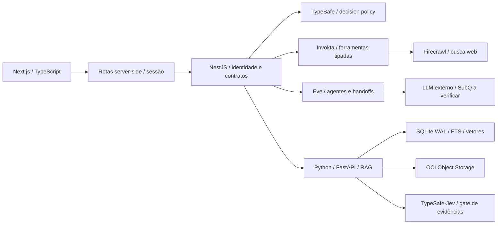

# NovaMente Atlas — especificação de implementação v3.0

Estado: baseline de kickoff, 17/10/2026 (America/Sao_Paulo). A solicitação atual prevalece sobre as versões anexadas. O usuário autorizou iniciar a implementação depois desta consolidação; não há nova etapa de aprovação implícita.

## 1. Problema, resultado e autoridade das fontes

Documentação técnica precisa tornar-se aprendizagem acessível, verificável e adaptada à pessoa. O Atlas reúne biblioteca documental, cinco tutores, relações entre conceitos, prática e grupos de estudo. A métrica principal é compreensão demonstrada e continuidade voluntária, não tempo de tela ou quantidade de prompts. “Aprendizagem acelerada” é objetivo a avaliar com usuários, nunca promessa de eficácia comprovada.

Precedência: pedido atual > briefing oficial ONE G10 (PDF de 6 páginas) para requisitos de avaliação > especificação mestra v2 Markdown para semântica e proveniência > HTML para direção visual > PDF completo v1 para detalhes complementares. O print anexado registra entregáveis e prazo do hackathon, não o design do aplicativo. O HTML é um protótipo com dados, scores e uploads fictícios: nenhum deles será tratado como integração real.

Requisitos oficiais não negociáveis: PDF/Markdown/TXT; segmentação, embeddings e busca vetorial; LLM e orquestração; pelo menos dois perfis e dois formatos; JSON estruturado; interface ou REST; originais e pacotes salvos no OCI Object Storage; três demonstrações a partir da mesma fonte. Persistência local ajuda no desenvolvimento, mas não substitui OCI na conclusão do MVP. Prazo registrado no painel: 24/11/2026, sujeito ao horário/regra oficial do programa.

## 2. Modelo do produto e histórias prioritárias

1. Como estudante, adiciono fontes a uma biblioteca no estilo NotebookLM e escolho quais uma conversa pode utilizar.
2. Como iniciante, escolho um objetivo em linguagem comum e recebo uma explicação curta sem precisar configurar técnicas de IA.
3. Como pessoa desenvolvedora ou gestora, uso a mesma fonte com profundidade, exemplos e vocabulário diferentes.
4. Como estudante, recebo tutorial, flashcards, quiz ou resumo executivo e posso exportar seu JSON.
5. Como leitor, abro qualquer citação na fonte original, página e versão corretas.
6. Como estudante, converso individualmente com um tutor que mantém sua persona e meu contexto autorizado.
7. Como estudante, entendo quando os tutores encaminham uma tarefa entre si e qual fonte sustentou o resultado.
8. Como usuário, aceito ou substituo o método sugerido automaticamente pelo decision model.
9. Como investigador, exploro analogias entre documentos e vejo seus limites e autoria antes de incorporá-las ao meu grafo.
10. Como estudante, sigo uma trilha de microtarefas gerada a partir de meus objetivos, conhecimentos declarados e resultados de exercícios.
11. Como estudante, ganho XP por uma resposta verificada, sem ganhar novamente por repetir a mesma ação.
12. Como membro, crio ou participo de grupo de estudo com chat, trilha compartilhada e mentor, sem expor minha biblioteca privada.
13. Como pessoa que prefere calma, reduzo movimento, escondo competição e mantenho acesso ao conteúdo e às fontes.
14. Como usuário, decido o que os agentes podem lembrar, exporto e apago memórias, e autorizo separadamente contribuição agregada à comunidade.
15. Como responsável pela plataforma, limito custos, tempo, ferramentas e chamadas entre agentes, e consigo auditar uma execução.
16. Como equipe ONE, demonstro os cenários e uploads OCI com comprovante de leitura e documentação reproduzível.

## 3. Agente, método e formato são entidades diferentes

| Agente | Persona estável e responsabilidade | Cor |
| --- | --- | --- |
| Nilo | Tutor paciente e preciso; explica sem humilhar ou infantilizar | #74D8F7 |
| Lumi | Exploradora curiosa; conecta fontes e explicita os limites das analogias | #85E7B8 |
| Prisma | Revisor crítico; verifica suporte documental e assume incerteza | #F4B46A |
| Fio | Criador organizado; transforma evidências em artefatos pedagógicos | #FA8C83 |
| Soma | Coach acolhedor; guia continuidade e prática sem pressão | #C5A7F5 |

Esses nomes vêm da v2; nomes divergentes no HTML são substituídos. Memória episódica individual por usuário/agente; memória de aprendizagem compartilhada entre os cinco agentes dentro do mesmo workspace; memória coletiva somente de conteúdo explicitamente publicado ou agregado com consentimento. Cada registro leva owner, scope, propósito, proveniência, consentimento, TTL, versão e trilha de alterações. Informações sensíveis e diagnósticos de saúde não serão inferidos.

Métodos: Socrático, Feynman, primeiros princípios, Warburg, pensamento sistêmico e revisão ativa. O decision model considera objetivo, nível declarado, evidências de domínio, preferências explícitas, tamanho das fontes, confiança e custo. Deve produzir JSON validado com motivo, incerteza e versão da política; falha ou falta de chave recorre a regras transparentes. O usuário pode substituir método e formato sem mudar a persona.

Formatos MVP: tutorial, flashcards, quiz com justificativas, resumo executivo. V1: plano de estudo, roteiro, áudio e comparativo. Sempre preservar `conteudo_adaptado` no contrato exigido pelo edital.

## 4. Arquitetura escolhida e papéis dos frameworks

Next.js App Router + TypeScript no frontend; NestJS como API/BFF de domínio e fronteira de ferramentas; Python 3.12/FastAPI para extração, recuperação e persistência. Eve e Invokta não são duplicados: Eve expressa agentes e ciclos, Invokta fornece ações com schema e autorização. Não adicionar LangGraph como terceiro orquestrador por herança dos PDFs. APIs reais e versões devem ser comprovadas no relatório de integrações. SDK não verificado fica explicitamente bloqueado, sem classes vazias simulando integração.

### Brains e Action Engines (incremento 0.2)

Cinco brains de domínio, um por persona, consultam fontes autorizadas e memória consentida, pedem a decisão pedagógica e invocam ações. Três Action Engines Invokta versionadas separam aprendizagem (`atlas-learning`), pesquisa (`atlas-research`) e memória/Dreamer (`atlas-memory`). Capacidades validam entrada/saída, tenant, permissões e orçamento; brains não podem conceder consentimento ou executar controles administrativos de memória. Geração e chat compartilham essa fronteira. Eve executa sessões e handoffs; o brain é uma abstração Atlas, não uma API nativa inventada do Invokta. Contratos, fluxo e limites estão em [brains-and-action-engines.md](architecture/brains-and-action-engines.md).

TypeSafe (link fornecido pelo usuário: https://typesafe.ai/) é motor de decisões/julgamentos tipados, não um gerador de texto nem modelo de embedding. A identidade histórica “Jev” dos documentos deve ser mapeada ao contrato do fornecedor após verificação. SubQ Snap (https://subq.ai/) é fallback desejado; suas capacidades e a compatibilidade da API precisam ser confirmadas. Configuração genérica de geração não prova compatibilidade SubQ. Embeddings possuem configuração e credenciais próprias.

Handoffs usam mensagens tipadas: run_id, sender, recipient, propósito, referências autorizadas, resumo, deadline, hops restantes e custo. Limite inicial: três handoffs, uma correção, uma busca web e duas gerações por execução; sem loops abertos. Falhas têm estado explícito e cancelamento. Sem raciocínio interno ou segredos nos traces enviados ao navegador.

## 5. RAG em três estratégias complementares

Ingestão: validar extensão e conteúdo, limite inicial de 10 MiB/100 páginas/300 mil caracteres, extrair por página, preservar offsets e headings, calcular SHA-256, armazenar original e manifesto versionado. PDF escaneado sem texto retorna aviso acionável; OCR fica assíncrono em V1. Nunca executar conteúdo de arquivos.

1. Vetorial puro: embeddings de passagens semânticas, filtro de tenant/documento antes do ranking, similaridade e top-k. É a base de comparação, não substitui contexto estrutural.
2. Híbrido: FTS por termos exatos + vetores + expansão da seção + metadados e, em V1, vizinhança do grafo. Combinação por reciprocal rank fusion (k=60), deduplicação por referência e reranking opcional.
3. LM RAG: preserva o documento inteiro como unidade; cria representações de documento e seções com intervalos de tamanho variável. Se o texto completo couber no orçamento de contexto reservado, injeta-o por inteiro. Se não couber, seleciona seções completas e marca explicitamente a estratégia como híbrida/section-context, jamais trunca silenciosamente e alega contexto integral. Continua mantendo passagens e embeddings exigidos pelo edital.

Decision model escolhe estratégia; política valida compatibilidade entre documentos, janela do gerador, limite de tokens e custo. Limites são configurações do servidor, não parâmetros livres do LLM. Envio de documentos inteiros a fornecedor externo deve ser explicado no consentimento.

Modo local sem chave: hashing lexical de demonstração + FTS, extração literal e citações reais. Não chamar esse hashing de embedding semântico, nem extração de síntese por LLM. Interface exibe “Modo local: trechos das fontes” e judge `not_evaluated`. Esse modo prova o encadeamento de dados, não satisfaz sozinho os critérios de IA do hackathon.

## 6. Grounding, outputs e qualidade

Cada citação contém documento, versão, página, seção, trecho e hash. Uma afirmação deve ser suportada por uma passagem autorizada. O gate determinístico verifica schema, ACL, existência de página/trecho e limites; depois TypeSafe/Jev classifica suporte/relevância/cobertura, sem transformar similaridade em confiança factual. Contradição bloqueia publicação; insuficiência tenta uma recuperação adicional ou abstém; indisponibilidade do judge retorna `not_evaluated`, nunca `supported` inventado. Limiares serão calibrados com dataset humano; nenhum score estático 0.98 do protótipo será copiado.

O `EducationalPackage` versionado guarda `schema_version`, id, status, document_refs, decision, profile, sector, agent_trace, `conteudo_adaptado`, quality, storage e timestamp. Pacotes OCI somente recebem `verified` depois de leitura de conferência. Artefatos locais declaram `provider: local`. Não persistir `status_upload: concluido` para bucket não configurado.

## 7. Interface e acessibilidade

Referência visual inicial: HTML anexado, edição Atelier: fundo #08090a, rail #0c0d0f, superfície #111316, bordas #22262b, acento #ff4f38, papel #ebe7df; Plus Jakarta Sans, Instrument Serif e JetBrains Mono preferencialmente locais. Mantém sidebar, área central editorial de estudo e painel de evidências em papel; tokens azul/menta/âmbar/coral/lavanda distinguem os cinco agentes. Cosmos e 8-bit são cartuchos opcionais, sem substituir a experiência calma padrão.

Fluxo central em até três ações: adicionar/selecionar fonte → dizer objetivo → começar. Método automático por padrão; controles avançados recolhidos. Modos foco e baixo estímulo, `prefers-reduced-motion`, foco visível, contraste AA e alvos de toque >=44px. Nenhum som automático ou pontuação por tempo de tela.

Motion.dev cuida das transições de layout/painel (180–240ms); Anime.js somente de feedback deliberado de conclusão (350–600ms) e movimento do explorador (450–900ms). Respeitar redução e pausar quando oculto. Componentes shadcn/Radix para controles e diálogos; Material UI para progresso/gamificação, com um único conjunto de tokens para evitar duas linguagens visuais e CSS duplicado. Grafo 2D sem WebGL obrigatório, limite inicial de 80 nós, relações explícitas/inferências/hipóteses/pessoais distinguíveis também por padrão de linha. Sugestões da IA só entram no grafo pessoal por ação do usuário.

## 8. Trilhas, exercícios e comunidade

Trilhas são planos versionados de competência e pré-requisitos, com nós de 3–6 minutos gerados por LLM a partir de fontes autorizadas e revisados pelo gate. Os mesmos agentes do chat ajudam dentro das missões. Adaptação usa respostas observáveis e preferências declaradas, sem rotular neurotipo. O usuário pode pular, revisar ou pausar.

Quiz: resposta correta mantida no servidor; tentativa gera feedback citável; XP só depois de acerto validado. Ledger com unicidade usuário+atividade+versão evita duplicação, inclusive com outro event_id. Nível inicial = floor(sqrt(XP/100))+1. Flashcard revelado sozinho não comprova domínio. Documentos adicionados e anotações facilitam descoberta, mas não geram XP irrestrito.

Comunidade amplia o MVP em incrementos: grupos temáticos, chat persistente, trilha coletiva e mentor; publicação seletiva de fontes e conexões; ranking semanal opt-in e limitado a eventos validados; denúncia, moderação e bloqueio antes de abrir grupos públicos. Biblioteca privada nunca é anexada por estar em um grupo. O primeiro corte permite grupo/chat num workspace local; não simula usuários reais ou contagens fictícias.

## 9. Dreaming individual e coletivo

Inspiração: https://www.dream-rsi.com/ (integração/biblioteca não presumida). Processo fora do caminho do chat: eventos consentidos → consolidação de preferências → proposta versionada de política/método → replay em avaliações fixas → revisão humana → canário → rollback. Aprimora memórias, prompts e escolha de técnicas, não pesos do modelo. Nunca altera autenticação, segurança, orçamento ou consentimento. Privado por padrão; coletivo somente com opt-in, agregação suficiente para impedir reidentificação e registros de origem. Sem treinar globalmente com PDFs ou conversas privados. Dreamer é parte basilar do primeiro incremento: serviço de memória independente do frontend, ciclos persistentes de proposta/avaliação/promoção/rollback e estados auditáveis. Sem provedores configurados, captura apenas eventos consentidos e registra o ciclo como aguardando avaliação; nunca finge uma melhoria avaliada. Com LLM e judge configurados, faz replay baseline/candidato sobre casos de fonte e rubrica, promove automaticamente apenas revisões pedagógicas de baixo risco que melhorem a avaliação e preservem fidelidade. Mudanças de autorização/segurança e política coletiva exigem revisão humana. Memória/consolidação podem ser apontadas a serviço externo por MEMORY_SERVICE_URL e token entre serviços: outra VM OCI ou Railway, com TLS/rede privada, orçamento e política de dados verificados; isso não transfere chaves ao frontend.

## 10. Oracle, recursos e custo

Alvo: Linux AMD64, 6 GB de RAM totais. Confirmar elegibilidade do SKU AMD e memória: um orçamento de 6 GB não significa que uma instância AMD de 6 GB seja Always Free. Não migrar silenciosamente para ARM nem provisionar recurso pago. OCI Object Storage é obrigatório, usando instance principal ou identidade de desenvolvimento via arquivo externo não versionado; bucket privado, prefixos por tenant, mínimo privilégio e readback.

| Recurso | Meta RAM reservada |
| --- | --- |
| SO + proxy/logs | 700 MiB |
| Next standalone | 500 MiB |
| Nest + Eve/Invokta | 400 MiB |
| Python + parser/índice (1 job) | 1.200 MiB |
| SQLite + cache limitado | 250 MiB |
| Margem e picos | >2.000 MiB |

São metas, não benchmarks. Sem LLM/GPU/Torch local, Redis, banco vetorial em serviço separado ou Rust no MVP. Construir imagens em CI, não na VM-alvo. Um worker de ingestão, uma geração concorrente por workspace, limite global dois, cache LRU limitado, backpressure/429, timeout e circuit breaker. Testar memória com cgroup 6GB e cargas reais antes de declarar capacidade. Runtimes Rust ficam na fase 2 somente após profiling mostrar benefício.

## 11. Segurança e configuração

Chaves Typesafe, gerador, embeddings, Firecrawl e OCI somente no servidor. `.env.example` comentado, sem valores funcionais, com grupos por serviço e instruções de origem. Nada secreto em `NEXT_PUBLIC_*`, bundle, trace, log ou JSON exportado. Não reutilizar tokens do Codex, cookies pessoais ou assinatura de ferramentas como credenciais de API.

Produção exige identidade autenticada, sessão HttpOnly/Secure/SameSite, tenant e user derivados do servidor, rate-limit, CSRF/origin e política de retenção/LGPD. Primeiro corte é desenvolvimento local de workspace único: bind em loopback, serviços internos com token compartilhado, recusa de modo público sem autenticação implementada. Não apresentá-lo como multiusuário seguro para Internet.

Busca Firecrawl só por ferramenta tipada e chave server-side, com domínio/URL validado e orçamento; bloquear loopback, RFC1918, link-local, metadata OCI, esquemas fora de HTTPS e redirects não validados. Primeiro corte expõe busca por termos via API do fornecedor; importação arbitrária por URL depende de hardening específico. Resultados web continuam rotulados com URL/data e não viram fatos do documento nem memória compartilhada automaticamente.

## 12. Primeiro incremento autorizado e sequência de execução

Entrega inicial funcional: monorepo; ambiente/example; biblioteca upload PDF/MD/TXT; extração e índice leve persistente; geração extrativa local citável e adapter LLM configurável; seleção automática por política e adapter Typesafe; cinco personas e etapas reais de processamento (handoffs somente quando executados pelo runtime); quiz/flashcards/tutorial/resumo; fonte clicável; ledger XP; base visual fiel ao HTML; navegação para agentes, grafo documental, prática e grupos/chat locais; integração OCI com readback quando configurada; ferramentas Eve/Invokta nas APIs verificadas. Registrar claramente os módulos que dependem de chave, API ou validação posterior.

Próximos incrementos do MVP: integração Typesafe/SubQ confirmada e avaliada; embeddings semânticos; cenários com dois perfis/dois formatos via LLM; OCI real; leitor PDF.js + anotações; validação em 6GB; autenticação antes da Internet; dataset judge e três demonstrações. Dreamer individual com replay e memória consentida faz parte deste primeiro incremento; falta de chave deve aparecer como dependência de execução, não remoção da arquitetura. V1: trilhas LLM completas e grafo físico. V2: grupos multiusuário moderados e promoção de memória coletiva com quorum e consentimento. Rust só fase 2. Essas prioridades não removem recursos do produto: limitam o que será anunciado como pronto em cada entrega.

## 13. Aceite e evidências

Testar comportamentos: upload válido/inválido e limite; separação por tenant; recuperação sem evidência; citações corretas e sem acesso cruzado; estratégias LM/vetor/híbrido; erro de fornecedor; quiz sem vazar gabarito e XP idempotente; ações entre agentes limitadas; URLs externas; armazenamento readback. Testes de contrato Python/Nest, build Next, smoke HTTP real e navegação desktop/celular por Playwright. Escaneados/OCR, autenticação pública, grupos multiusuário e dreaming são gates separados. Nenhum teste sem chave valida um provedor externo.

## 14. Decisões ainda dependentes de evidência

Confirmar modelos SubQ, limites/contexto/preços, API TypeSafe/Jev e política de dados; forma de auto-hospedar Eve; limites de recursos das versões SDK; região/SKU/cotas Oracle; termos de fontes; política de consentimento e moderação. Novas fontes serão registradas em `docs/research/integrations.md`. Antigravity CLI só será instalado com distribuição oficial verificável; pacote homônimo placeholder não é o produto Google.
