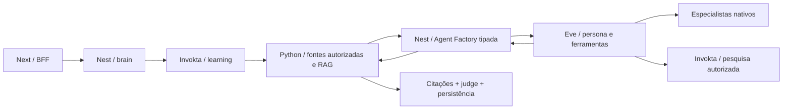

# Atlas 0.3 — Agent Factory Eve e operação em 4 GB

Especificação de execução, 20/10/2026 (America/Sao_Paulo). Complementa
`SPEC.md`; o orçamento atual de 4 GB disponíveis prevalece sobre os 6 GB anteriores.
Este documento descreve o alvo. Consulte `STATUS.md` para as evidências de execução.

## 1. Entrega e Git

O repositório Oracle e `No-Country-simulation/nuevamente-g10-latam-Equipo-4`
recebem os mesmos commits. A cópia inicial preserva os dois históricos: o destino
já continha uma importação com árvore idêntica. Não usar force push nem mirror
destrutivo. `.env`, bancos, documentos privados e credenciais ficam fora do Git.

## 2. Quem faz o quê

- Next: interface Atelier e BFF, sem credenciais de fornecedores no navegador.
- Nest: identidade local, decisões, brains e Action Engines reais do Invokta.
- Python: documentos, RAG, validação de citações, persistência e gates Dreamer.
- Eve: execução efetiva dos turnos generativos e conversas entre especialistas.
- TypeSafe: decisão e judge; não é modelo de geração ou embeddings.

Brain é uma abstração Atlas, não um export presumido do Invokta. A Agent Factory
centraliza personas, propósitos, schemas, autenticação e limites de sessões Eve.
Não criar cinco servidores Eve só para representar cinco personas: um root com
persona autenticada e quatro especialistas nativos mantém o deploy menor.

## 3. Fluxo verificável

Python envia uma tarefa pronta com evidências e schema conhecido. A factory não
chama novamente `atlas.generate`: isso criaria recursão. Ferramentas do agente
não concedem consentimento, apagam memória ou mudam limites. Resultados ainda
passam pela validação Python e pelo judge antes de publicação.

## 4. Personas e contratos

Um catálogo versionado é a fonte das cinco personas: Nilo, Lumi, Prisma, Fio e
Soma. É consumido pelo bootstrap, brains e instruções Eve. Método e formato
continuam independentes da persona. A factory aceita somente propósitos
conhecidos: material pedagógico, replay pedagógico e proposta de política
Dreamer. Cada propósito tem schema estrito, limites e validação de saída.

O contexto e os documentos são dados não confiáveis. Não podem alterar identidade,
permissões, instruções de segurança ou orçamento. Traces registram somente
identificadores e ações executadas; nunca raciocínio interno ou tokens secretos.

## 5. Autorização e ferramentas

A API local continua protegida por token interno. Sessões Eve recebem tickets
assinados, de curta duração, com tenant, persona, propósito e permissões mínimas.
O canal valida assinatura/expiração; o bridge de ferramentas revalida o ticket e
chama Invokta com principal de brain. O ticket não entra no prompt. Nunca dar
ao modelo uma ferramenta genérica de chamada administrativa com o token interno.

Busca web é Firecrawl hospedado, até três resultados. Referências externas não
substituem as citações documentais. Delegação nativa tem orçamento global e
especialistas não delegam recursivamente. Sem shell ou browser de scraping local.

## 6. Dreamer basilar

O mesmo runtime Eve gera propostas e conteúdo de replay. Python preserva os
gates: consentimento, revisão persistente, três casos, baseline versus candidato,
suporte documental, melhora mínima, promoção versionada e rollback. Uma revisão
não pode alterar ferramentas, segurança ou permissões. Não há alteração de pesos.

Jobs devem sobreviver ao reinício, possuir idempotência, lease, tentativas limitadas
e estados auditáveis. Agendamento local é o padrão; Trigger.dev pode disparar o
mesmo trabalho por contrato autenticado. Payloads externos levam IDs, não PDFs,
conversas nem credenciais. Revogação/forget invalidam trabalhos antigos.

Apagar memória Atlas não significa apagar automaticamente histórico durável de
Eve ou cópias de terceiros. A documentação deve explicitar essa fronteira e o
procedimento de retenção; não inventar uma API de purge. Sessões são isoladas e
nenhuma sessão antiga é reutilizada como memória depois de revogação.

## 7. Qdrant, MongoDB e Trigger.dev

Interpretamos “Quadrant” como Qdrant. Banco vetorial não substitui o registro
transacional de consentimento/XP/políticas. Qdrant é opcional e pode ser externo;
filtros por tenant/documento e versão de embedding são obrigatórios. Falha de
serviço configurado não pode virar hashing local silenciosamente.

MongoDB é opcional externo para projeções de metadados, sem textos privados por
padrão. Não migrar transações do SQLite apenas presumindo economia de RAM.
Consultas têm filtro de tenant, projeção explícita, limite e índice. Projeções não
autorizam acesso nem substituem a fonte de verdade. Evitar processos locais de
bancos não necessários ao caminho usado pelo produto.

Trigger.dev deve ser hospedado ou externo. O guia oficial de self-host pede
6+ GB para webapp e 8+ GB para worker, incompatível com nosso envelope total.
Não instalar o stack completo na VPS. Sem credenciais, o scheduler local funciona.

## 8. Recursos e Oracle

| Processo | Limite inicial proposto |
| --- | --- |
| Next | 384 MiB |
| Nest | 384 MiB |
| Python | 896 MiB |
| Eve | 896 MiB |
| Total principal | 2560 MiB |
| Qdrant local opcional | +512 MiB |

São limites a validar, não consumo medido ou garantia de capacidade. Os outros
4 GB da VPS de 8 GB pertencem a outras cargas; não são margem do Atlas. Inferência
é externa. Uma geração/parser de cada vez, recusas 429 e filas limitadas. Imagens
devem ser construídas em CI, fora da VPS de operação. Sem Redis, Mongo local,
Trigger self-host, GPU, modelo local ou Rust nesta fase.

OCIR guarda imagens Docker. Object Storage guarda originais e JSON pedagógico
com readback obrigatório no MVP. A VM executa os containers. Imagens não incluem
`.env`, bancos, PDFs privados ou arquivos PEM. Runtime Eve tem volume durável e
rede interna; reverse proxy externo, se adotado, deve encaminhar tanto `/eve/`
quanto `/.well-known/workflow/`. Não publicar antes de autenticação multiusuário.

## 9. Aceite e documentação

Testes comportamentais: roteamento de personas, schema por propósito, rejeição de
tickets adulterados/expirados, limites e permissões Invokta, cancelamento e replay,
idempotência/reinício de jobs, filtros Qdrant e ausência de fallback silencioso.
Executar typecheck, build, testes Python/Node e smoke HTTP. Chaves reais ausentes
significam integração remota não verificada, mesmo com SDK compilado.

README e guia PDF devem ensinar instalação, configuração opcional, fluxo de dados,
como adicionar persona/ação, operações, backup, diagnóstico, deploy e retenção.
Registrar claramente o que foi testado com mocks e o que exige credenciais.

## 10. Fontes primárias

- Eve 0.80.1: documentação instalada em `node_modules/eve/docs`, especialmente
  `guides/deployment/self-hosting.md`, `guides/dynamic-capabilities.md`,
  `tools/workflows.mdx`, `concepts/security-model.md` e documentação do client.
- Invokta 0.9.0: pacote e guia oficial `vinilana/invokta`.
- Trigger: https://github.com/triggerdotdev/trigger.dev/blob/main/docs/self-hosting/docker.mdx
- Qdrant: https://github.com/qdrant/qdrant/blob/master/config/config.yaml
- MongoDB: https://github.com/mongodb/docs/blob/master/source/core/wiredtiger.txt

Versões de runtime estão fixadas no lockfile. Não houve provisionamento de
serviços pagos nem validação de fornecedores remotos apenas por esta pesquisa.
