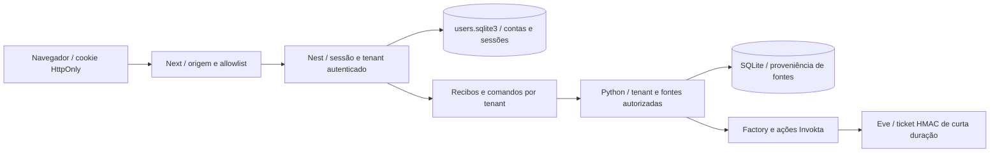

# Autenticação e builds integrados — 11/11/2026

Esta atualização integra o login por e-mail da equipe ao incremento 0.6.
Complementa a arquitetura de conexões e o guia do cliente ChatGPT local.
As branches foram testadas em conjunto; a liberação pública continua dependendo
da validação operacional e de segurança, distinta de compilar e passar nos testes.

## Dois acessos diferentes

- `ATLAS_REQUIRE_LOGIN=0`: workspace local compartilhado, protegido pelos tokens
  internos e pelo bind em loopback. `/login` explica esse modo.
- `ATLAS_REQUIRE_LOGIN=1`: `/login` oferece cadastro e entrada por e-mail/senha.
  Next define cookie HttpOnly/SameSite=Lax, Secure sob HTTPS. Next e Nest precisam
  receber a mesma flag; ambos os perfis Compose fazem esse encaminhamento.
- `/login/local`: guia do aplicativo pessoal com OAuth oficial ChatGPT e cofre
  do SO. A assinatura pessoal não é usada no servidor Oracle. Essa autorização
  não substitui a conta por e-mail do Atlas.

Sem cookie, `/workspace` e `/studio` direcionam ao login no modo autenticado.
Essa checagem apenas orienta a navegação: o Nest valida a sessão em cada pedido.
Um cookie inventado não concede acesso aos documentos ou comandos.

## Caminho da identidade



Senhas usam scrypt; sessões aleatórias são validadas no servidor. Tentativas de
login são reservadas transacionalmente antes de scrypt, inclusive em concorrência.
O tenant vem da sessão validada, propagado por AsyncLocalStorage no Nest e por
ContextVar no Python. Contextos são restaurados ao terminar o pedido ou job.
O runner usa o tenant do job persistido, não um tenant escolhido pelo chamador.

Administradores são concedidos offline pelo ID exato da conta:
`cd apps/api && node dist/auth/grant-admin.js usr_<id>`, com o mesmo
`ATLAS_DATA_DIR` da API. Declarar um e-mail no cadastro não concede administração.
O painel de conexões exige esse papel quando o login está habilitado.

Upload continua em streaming no BFF e com temporário privado na API, limitado a
80 MiB, com admissão antes do corpo e parser isolado. Fontes, pacotes derivados,
histórico e recibos mantêm filtro de tenant e proveniência; excluir uma fonte
invalida seus derivados. O login não altera limites de contexto do LM RAG.

## Build e regressão

O runner é Ubuntu 24.04. Instala-se o Chromium fixado pelo Playwright; o CI
verifica suas bibliotecas e inicia o navegador antes das jornadas. Electron
usa instalador explícito, verificação de bibliotecas e helper de sandbox.
Não há alteração dos asserts ou dos gates para tolerar falhas de preparação.

Após instalar dependências e preparar o submódulo oficial do cliente opcional:

```bash
npm run check:env
npm run typecheck
npm test
npm run build
npx playwright install chromium
npm run test:auth
npm run test:runtime
npm run quality
npm run agent:build -w @atlas/api
npm run test:eve-auth
npm run test:e2e
```

`test:auth` inicia Next/Nest/Python isolados com login obrigatório. Confere duas
contas, upload de 80 MiB, fonte/pacote/exclusão sem acesso cruzado, logout,
registro e login reais pelo navegador. O navegador precisa estar instalado.

`test:eve-auth` inicia o Eve compilado com segredo sintético e diretório
provisório. Um ticket válido precisa criar e encerrar sessão; tickets inválidos
ou adulterados precisam ser recusados. Nenhum turno de LLM é solicitado.
O canal lê `process.env` em runtime Node; compilar sem testar esse caminho não
comprova autenticação. Os três testes nativos e as quatro imagens continuam no CI.

OAuth real/assinatura, cofre de SO real, readback OCI, carga em 4 GiB e avaliação
operacional de produção têm evidências próprias; não são certificados por esses
smokes com dados sintéticos. Os limites de recursos e o Dreamer permanecem na
arquitetura anterior.
