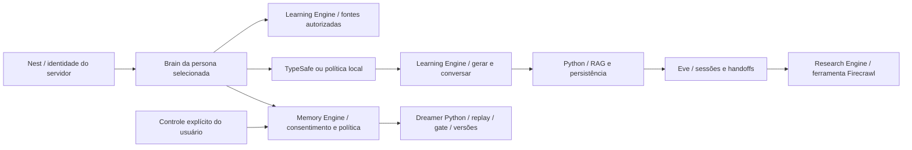

# Brains e Action Engines — Atlas 0.2

O kickoff anterior usava duas capacidades Invokta diretamente no controller. A separação de domínio agora é explícita: cinco brains decidem; três Action Engines versionadas executam resultados com contratos e autorização. Geração, chat, pesquisa, judge e controles de memória passam por `engine.invoke`.

Invokta 0.9.0 oferece `createEngine`, `defineCapability`, schemas, acesso e cancelamento. Não há um construtor `Brain` nessa API. Os brains são implementação de domínio do Atlas sobre essas primitivas. Eve continua responsável por sessões de modelo e handoffs entre especialistas. TypeSafe é o provedor de decisão/judge; a política local continua um fallback declarado.

## Brains

`apps/api/src/orchestration/brains.ts` registra Nilo, Lumi, Prisma, Fio e Soma com persona, propósito, versão e capacidades. O brain selecionado:

1. Valida o pedido, sem aceitar principal, tenant, decisão ou permissões do cliente/modelo.
2. Lê fontes pelo Learning Engine e rejeita IDs não autorizados antes da decisão.
3. Lê consentimento/política pelo Memory Engine; política sem consentimento não segue ao decision model.
4. Usa o tamanho real das fontes e a preferência aprovada do Dreamer para selecionar método/RAG, preservando escolhas manuais.
5. Invoca a capacidade de geração ou chat com principal de brain derivado pelo servidor.

Geração e chat usam esse mesmo caminho. O chat deixou de usar um tamanho constante de 30.000 caracteres e memória nula. O processamento Python revalida dados, evidências e a revisão de consentimento; uma leitura anterior no brain não autoriza escrita após revogação.

## Action Engines

`apps/api/src/orchestration/actions.ts` define engines independentes na mesma aplicação Nest, sem adicionar processos ou bancos.

| Engine / versão | Capacidades |
| --- | --- |
| `atlas-learning` / 0.2.0 | `atlas.sources`, `atlas.generate`, `atlas.chat`, `atlas.judge` |
| `atlas-research` / 0.2.0 | `atlas.web-search` |
| `atlas-memory` / 0.2.0 | `atlas.memory.status`, `.consent`, `.cycle`, `.rollback`, `.forget` |

Cada capacidade tem schema de entrada/saída, regra de acesso e timeout. Portas injetadas encapsulam Python, TypeSafe e Firecrawl. O Invokta valida também a resposta do provedor e propaga cancelamento aos adapters HTTP de cognição e pesquisa. Anotações identificam leitura, acesso externo e exclusão destrutiva. O backend Python mantém o algoritmo de replay e a transação de promoção/rollback; o Memory Engine é sua fronteira de domínio autenticada.

Somente o backend constrói os principals. Brains podem consultar fontes/memória, gerar/conversar, pesquisar e julgar. Não podem conceder consentimento, iniciar ciclos administrativos, apagar memórias ou reverter políticas. Esses controles exigem o principal de controle do workspace. Todas as ações conferem o tenant confiável do servidor. Isso não substitui a autenticação multiusuário ainda pendente para publicação na Internet.

Na exclusão com memória externa, o engine tenta o apagamento remoto e sempre limpa a cópia/histórico local, inclusive quando o serviço remoto falha. A falha continua sendo reportada; não é apresentada como exclusão remota concluída. Sem memória externa, há uma única exclusão local.

## Integração e observabilidade

O endpoint interno autenticado `GET /v1/orchestration` retorna o catálogo de brains/engines, versões e capacidades, sem chaves ou memórias. Não está na allowlist do proxy público Next. As rotas existentes e o contrato da interface permanecem compatíveis; a ferramenta Eve de pesquisa chega à mesma capacidade por `/v1/web/search`.

Uploads, leitura de documentos, quiz/XP e grupos ainda têm adapters próprios nas rotas Nest; esta alteração não afirma que toda a API migrou para Action Engines. A migração futura deve manter semântica de idempotência e schemas específicos. Não foi adicionado MCP público nem um segundo runtime de agentes.

## Validação

Testes executam `@invokta/core` real com portas controladas: descoberta/schema/versionamento, acesso entre tenants, negação de ações administrativas a brains, injeção de campos, resposta inválida de provedor, cinco personas em geração/chat, fontes não autorizadas, consentimento revogado, falha de memória externa e cancelamento. Chamadas de modelo/Firecrawl continuam dependentes de credenciais; não são simuladas como inferência real.

As medidas de RAM dos containers no STATUS são do incremento anterior. Esta versão mantém os mesmos processos, mas não reutiliza aquelas medidas como um novo benchmark.
