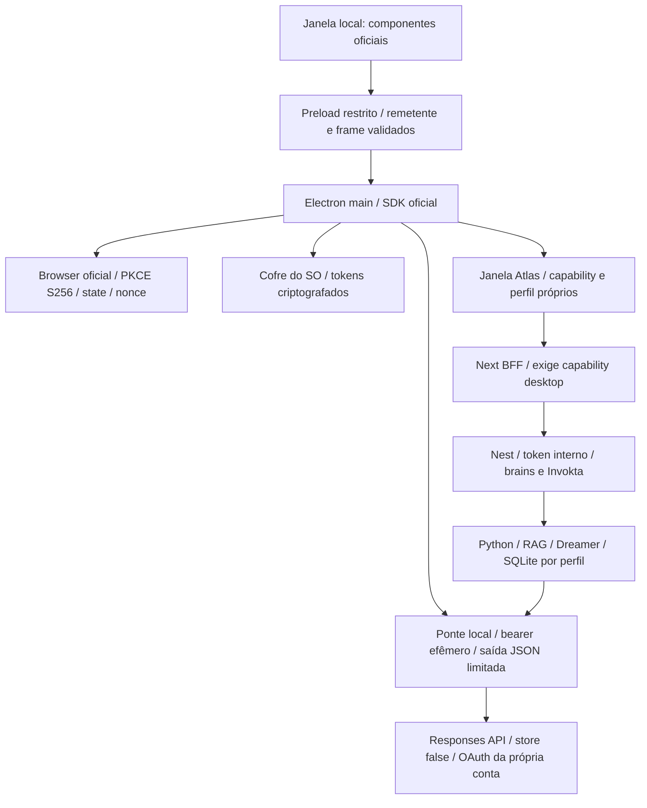

# Atlas 0.6 — ChatGPT local e Oracle

10/11/2026. Complementa a arquitetura 0.5 e o ciclo de vida das fontes.
Decisão autorizada pelo responsável: oferecer o fluxo oficial local e preservar
separadamente o deployment Oracle. Login do ChatGPT não cria uma conta pública
Atlas, não autentica o estúdio hospedado e não comprova quota disponível.

## Dois perfis explícitos

| Perfil | Onde roda | Geração | Persistência e autenticação |
| --- | --- | --- | --- |
| Oracle / API | Next, Nest, Python e Eve na infraestrutura da equipe | Factory Eve, ações Invokta, API configurada; Jev/Firecrawl opcionais | Workspace local até autenticação multiusuário; documentos/JSON OCI no aceite |
| ChatGPT local | Electron + Next, Nest e Python no computador do estudante | SDK oficial local, Responses, geração direta de texto/JSON | OAuth e cofre do SO; dados por perfil; HTTP só loopback e capability privada |

O SDK atual aceita texto, não ferramentas nativas Eve. O launcher escolhe
`ATLAS_AGENT_RUNTIME=direct` explicitamente. RAG, roteamento, validação das
citações, ações Invokta, trilhas, idempotência e consentimento Dreamer continuam
no backend. Não anunciar debate Eve nesse perfil. Dreamer mantém replay/gates;
sem Jev configurado não promove uma política semanticamente avaliada.
Conexões auxiliares podem ser configuradas separadamente no painel; não passam
a usar a assinatura por inferência. O launcher não herda chaves de fornecedores.

## OAuth e limite de confiança

DevKit oficial fixado em `0a36fefeb913055c8c7a1a29b63d82b96b2e841a`.
Registro dinâmico, callback `127.0.0.1` com porta automática e verificação OIDC
ficam no SDK, sem reimplementar o protocolo. Login e `sharing` são distintos:
reconsentimento só após clique explícito. Usar somente os modelos do catálogo
da conta. O indicador usa `source=unknown`: login não determina plano versus
créditos, saldo, preço ou janela de quota. “Manage usage” abre a URL oficial.

Tokens OAuth só existem no processo principal/SDK e no cofre do SO. Nunca vão
para Next, Nest, Python, renderer, env ou logs. Linux `basic_text` é recusado.
O arquivo da master key do cofre de conexões também usa criptografia do SO.
Os serviços recebem um bearer efêmero diferente, válido só para a ponte local.
Next recebe apenas URL/token interno/capability; não recebe master nem bearer LLM.

IPC exige janela conhecida, frame principal e URL exata do onboarding ou origem
local autorizada. Node está desligado no renderer; contextIsolation, sandbox e
webSecurity permanecem ativos. Popups, webviews, navegação externa e permissões
são recusados. Uma sessão Electron por perfil injeta capability somente nos
pedidos da própria janela para a origem Atlas. O BFF recusa leitura e escrita
sem ela. Nenhum token OAuth é usado como cookie ou capability de interface.

Isto não protege contra malware com acesso à conta do SO, depuradores do usuário,
captura da sessão já desbloqueada ou acesso administrativo à máquina. Não é um
substituto de autorização multiusuário na VPS. Não abrir portas públicas.

## Recursos e efeitos

O launcher usa três processos de aplicação, sem Eve nem modelo pesado local.
Electron é dependência opcional do computador do estudante e fica fora do build
Docker/VPS. Cada perfil tem dados SQLite, cofre e origem web persistentes; trocar
conta não troca documentos. Desconectar encerra serviços, não apaga a biblioteca.
Remoção de fontes usa os mesmos comandos e limpeza de dependentes/histórico.
O histórico só alimenta estudos quando suas fontes estão autorizadas na seleção
atual; turnos sem proveniência são excluídos desse contexto. Legado com contexto
não-vazio fica em quarentena até reconstrução/retirada revisada (schema4).

Uma geração por vez; entrada da ponte até512KiB, saída até512KiB e2500 tokens;
deadline55s na chamada ao SDK. JSON completo e depois schemas/citações do Python.
Resposta incompleta ou inválida não vira material pronto. Sem retry de429 nem
fallback para API paga. Chaves manuais de geração são ignoradas e não podem ser
salvas/removidas nesse perfil. Endpoint LLM fora da ponte IPv4 local é recusado.
Notificações de quota/reconexão usam códigos públicos permitidos, sem detalhes
brutos; replay idempotente preserva o aviso e não chama o modelo novamente.

Temporários usam pasta0700 e manifesto de processo. SIGTERM/exit remove cópias
temporárias; após SIGKILL, restart só limpa diretórios reconhecidos de processos
encerrados. Não remove pastas ativas, symlinks ou originais canônicos da biblioteca.
Admissão permanece ocupada se o cliente desconectar durante processamento.

Startup pode ser cancelado. Troca de conta/quit espera a limpeza, mata somente
filhos próprios e escala após prazo. Pipes são drenados. Falha de shutdown impede
iniciar outro perfil; não deixar um Python órfão consumindo recursos.

## Código e reprodução

`integrations/chatgpt-desktop/src`: main/IPC, janelas, ciclo de vida, processos,
portas, criptografia e ponte. `renderer`: UI sem SDK de autenticação em runtime.
`devkit`: submodule oficial; `patches/bounded-responses.patch`: única modificação,
encaminha teto de saída/JSON para Responses; não muda OAuth ou armazenamento.
`prepare-devkit.mjs` exige pin e diff completo exatamente iguais ao patch. Recusa
mudanças extras em vez de resetar o checkout. Build e setup o executam.

Typecheck/build/testes usam instalação opcional com lock próprio. Quality mede
complexidade/parse/ciclos do código próprio, inclui CJS/preload e vincula sources,
manifestos, testes, patch e revisão do DevKit no digest. Imports de SDK confiável
no renderer falham; apenas import de tipos é permitido. CI compila em árvore
limpa e testa Electron com provedor sintético, sem credenciais reais.

A versão inicial está disponível por código-fonte em Linux POSIX; instalador,
assinatura/notarização, Windows nativo/macOS e uso real de uma conta continuam
sem validação. Consulte [guia de execução](../../integrations/chatgpt-desktop/README.md)
e [pesquisa oficial](../research/sign-in-with-chatgpt-verified.md).
