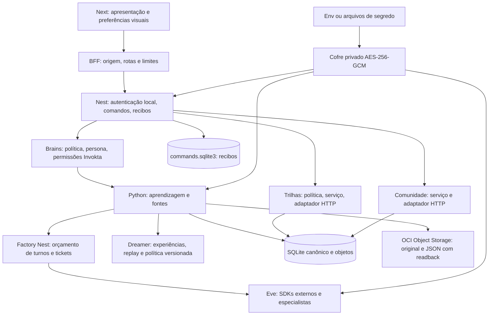
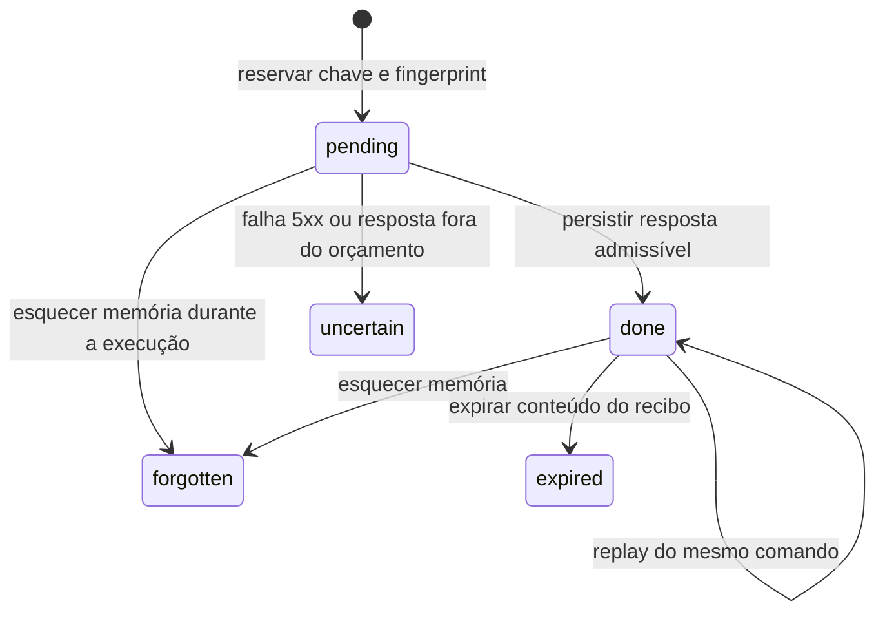

# Atlas 0.5 — arquitetura do monólito modular

28/10/2026 · baseline `3a58543` · branch `feat/andre-pos-mvp-quality-20261028`.
Este documento descreve a implementação desta branch. Os módulos futuros estão
identificados no backlog; não são serviços já implantados.

## 1. Decisão central

Um produto, contratos compartilhados e quatro processos operacionais. Next
apresenta; Nest recebe comandos, resolve identidade local, brains e Invokta;
Python executa aprendizagem, RAG, trilhas, comunidade e Dreamer; Eve executa
personas e ferramentas. Separar processos não exige multiplicar bancos,
brokers, servidores de modelos ou deploys por agente. É um monólito modular
poliglota com um pacote de contratos e composição explícita.

## 2. As gavetas do código

| Gaveta | Entrada pública | Responsabilidade e dependências |
| --- | --- | --- |
| Composição Nest | `apps/api/src/main.ts`, `context.ts` | Conectar implementações; registrar controllers e middleware. Não importar estas raízes em regras puras. |
| Adaptadores Nest | `apps/api/src/modules/*` | Sete controllers pequenos: conexões, biblioteca, aprendizagem, comunidade, memória, interno e trilhas. Validar entrada e encaminhar comandos. |
| Comandos | `apps/api/src/commands/receipts.ts`, `http.ts` | Reserva/replay persistente, quotas e invalidação. Não sabe ensinar nem chamar LLM. |
| Factory/brains | `apps/api/src/orchestration/*` | Autoria de brains, capabilities Invokta, tickets, equipes, síntese e orçamento. |
| Conexões | `apps/api/src/connections/*` | Criptografia, fontes env/arquivo/manual, testes de catálogo e SDK dinâmico. |
| Trilhas | `services/cognition/atlas/trails/policy.py`, `service.py`, `http.py` | Regras puras, casos de uso transacionais e HTTP. Planejador inicial explícito, quatro etapas. |
| Comunidade | `services/cognition/atlas/community/service.py`, `http.py` | Grupos/mensagens locais, escopo e paginação limitada. Não simula outros participantes. |
| Aprendizagem | `learning.py`, `attempts.py`, `progression.py` | Geração citável, gabarito privado, eventos imutáveis, recompensa única e projeção de nível. |
| Fontes | `rag.py`, `extract.py`, `reindex.py`, `vector_index.py` | Parser isolado, limites, recuperação e índice versionado. |
| Dreamer | `dreamer.py`, `rollout.py`, `replay.py`, `jobs.py` | Memória consentida, exploração, consolidação, simulação de histórico, promoção e rollback. |
| Persistência | `store.py` | SQLite, migrações aditivas e objetos local/OCI. As tabelas são de domínio mesmo usando uma infraestrutura comum. |
| Interface | `apps/web/components`, `lib/api.ts`, `lib/server/proxy.ts` | Apresentação, navegação, IDs de comandos e segurança do BFF. Não decide XP, domínio ou progressão. |
| Contratos | `packages/contracts` | Tipos TS e catálogo de personas. Schemas Python e Zod validam fronteiras reais. |

A decomposição é incremental. `learning.generate`, RAG, Factory e componentes
visuais legados ainda têm complexidade elevada, registrada pelo analisador.
Não confundir número de linhas comprimidas com simplicidade. O roadmap inclui
extração de portas/repositórios e decomposição da UI preservando comportamento.

## 3. Regras de negócio pertencem ao servidor

O browser pode escolher objetivo, formato, perfil e tutor, e confirmar uma
leitura. O servidor valida se as fontes pertencem ao workspace, escolhe método
automático, aplica limites, confere citações, julga material e guarda o pacote.
No quiz, só o servidor lê o gabarito; XP é único por pacote/questão. A projeção
retorna `level_start`, `level_end` e `level_percent`; a UI não recalcula níveis.

A trilha fixa hash/versão das fontes, perfil e agente. O servidor devolve
`unlocked`; não confiar no atributo `disabled` de um botão. Concluir leitura
registra `user_acknowledgement`; concluir quiz exige `server_verified_quiz`.
O roteiro `local_template_v1` não é apresentado como planejamento por LLM.
Materiais das etapas passam pela mesma cadeia de brains/Invokta/Eve/RAG.

## 4. Semântica de idempotência e falhas

Um ID de comando identifica uma intenção de escrita, não um usuário. O escopo
é `(tenant, método/caminho, chave)`. O fingerprint SHA-256 usa JSON canônico;
não gravamos o corpo da requisição no ledger. Reserva SQLite `BEGIN IMMEDIATE`
ocorre antes do handler, sem manter transação aberta durante chamada remota.

`pending`, `uncertain`, `expired` e `forgotten` recusam reexecução com 409.
Fingerprint diferente também recebe 409. Nenhuma lease expirada libera
automaticamente uma operação que poderia ter cobrado um provedor. Não existe
garantia universal de exactly-once entre banco, LLM e OCI. Resultado incerto
exige reconciliação pelo estado e pelo operador; novo ID é uma nova intenção.

O cliente mantém fingerprints/IDs somente em memória e reutiliza o ID em retry
manual após falha de transporte. Reload perde esse mapa: verificar estado antes
de repetir uma ação incerta. Isso permanece uma limitação documentada.
Clientes REST antigos sem chave ainda são aceitos neste incremento; não têm
replay garantido. O contrato obrigatório de comandos será fechado no P01.

Limites padrão: 20 mil linhas, 64 MiB de conteúdo de recibos, 512 KiB por
resposta e sete dias para expirar conteúdo, com varredura a cada minuto. Tombstones continuam impedindo
reexecução; a quota de linhas requer manutenção explícita. TTL não é autorização
para esquecer que um efeito aconteceu. Recibos guardam respostas de estudo no
volume privado, nunca chaves manuais. Esquecer memória invalida também recibos
concluídos e pendentes desse workspace antes da exclusão externa; o recibo da
própria exclusão permanece reproduzível sem executar novamente o comando.
Consentimento e rollback também participam do ledger. SQLite/WAL/backups exigem a política de
retenção; isso não promete apagamento forense nem exclusão nos fornecedores.

`quiz_attempts` dá uma segunda proteção de domínio: `event_id` é imutável por
workspace, resposta duplicada retorna o resultado original, payload diferente
conflita. XP e recibo da tentativa são transacionais. O evento Dreamer ocorre
após o commit; uma queda nesse intervalo pode perder a experiência, sem repetir
XP. Outbox durável e reconciliação são parte de P01.

## 5. Identidade dos agentes

| ID persistido | Nome anterior | Nome público | Propósito |
| --- | --- | --- | --- |
| `nilo` | Nilo | Guia | Explicar e orientar o próximo passo. |
| `lumi` | Lumi | Faísca | Investigar conexões e analogias com limites. |
| `prisma` | Prisma | Prisma | Examinar afirmações, suporte e incerteza. |
| `fio` | Fio | Trama | Organizar conhecimentos e materiais. |
| `soma` | Soma | Elo | Apoiar continuidade sem pressão. |

Catálogo compartilhado versão 0.5.0. Não migrar IDs nas tabelas nem renomear
diretórios de sessões/artefatos. O nome personalizado do usuário continua uma
preferência visual local, sem conceder capacidades ou consentimento.
Os agentes podem oferecer vínculo pedagógico sem se apresentarem como pessoas
reais ou substitutos de relações humanas. Competição é interna, orientada por
suporte e utilidade; não incentivar disputa entre alunos como requisito.

## 6. Máquina enxuta e distribuição

Padrão: Next 384 MiB, Nest 384 MiB, Python 896 MiB, Eve 896 MiB, total
2560 MiB em limites. Com 4096 MiB disponíveis, restam nominalmente 1536 MiB
para sistema, runtime de containers, cache e picos. Reserva não é medição.
Qdrant local adiciona 512 MiB e só se justifica após corpus/latência medidos.
Mongo é projeção opcional, Trigger externo é opcional; nenhum é padrão.
Não rodar Trigger self-host, inferência local ou builds na VPS.

Parser PDF já usa subprocesso com 512 MiB de endereço, CPU 15s, timeout20s,
100 páginas, 10 MiB/arquivo e 300 mil caracteres. O trabalho pesado de geração
tem backpressure de um por processo. Vários workers Python multiplicariam esse
orçamento: manter um worker até a fila compartilhada de P07.

Builds permanecem em Actions, software no GHCR por SHA; VPS faz pull e
`up --no-build`. Original/JSON do produto vão ao OCI Object Storage no aceite.
Não retirar a exigência vetorial do edital: fluxo cotidiano pode ser lexical,
mas o aceite exige embedding semântico real e três cenários verificáveis.

## 7. Confiança, segredos e operação pública

A versão local valida token interno, origem do BFF, schemas, escopo documental
e capacidades dos brains. Isso não autentica um aluno na Internet. Não expor o
workspace até P02: sessão autenticada, RBAC, tenant/user derivados do servidor,
CSRF, autorização por recurso e cofre por proprietário.

Ambiente/arquivos e cofre manual são alternativas. Next nunca monta cofre nem
master. SDKs externos continuam no Eve. ChatGPT por assinatura permanece somente
dev local explicitamente habilitado; não é OAuth público do Atlas. Jev é decisão
e judge, Firecrawl é pesquisa, embedding é um slot independente e opcional na
operação cotidiana. SubQ permanece sem fallback automático não confirmado.

## 8. Gates e próximos pontos de extensão

Esta branch exige testes de unidade/concorrência, HTTP e navegador, types/build,
schemas de env e análise estrutural. Quality Engine é usado como biblioteca de
medição em revisão fixada; não instalamos seu MCP global nem alteramos sua
política administrativa humana. TS/Python são medidos por algoritmos distintos.
O grafo runtime completo TS considera aliases de cada workspace; Python recebe
complexidade AST/Radon. Não há alegação de medição cognitiva Python equivalente
ao SonarJS. UI declarativa usa o mesmo ratchet: dívida prévia é explícita; funções novas
ou regressões acima do limite falham. E2E continua obrigatório.

Release continua bloqueado por autenticação, fornecedores/OCI, carga4GB,
backup/restauração, avaliação pedagógica e revisão humana. A revisão de outro
agente é uma checagem adicional de engenharia e não concede exceções humanas.
