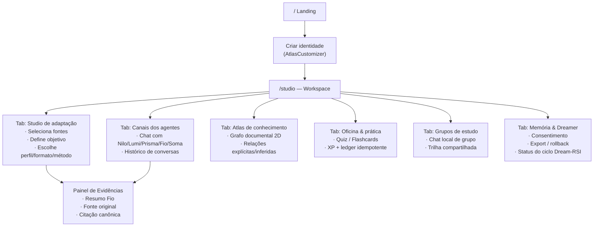

# Atlas AI — Frontend Architecture & System Design

> [!NOTE]
> Baseado em: `SPEC.md`, `STATUS.md`, `SPEC_AGENT_FACTORY_V03.md`, código real em `apps/web`. Serve como referência viva para mocks, decisões de componentes e handoff de design.

---

## 1. Stack e decisões técnicas

| Camada | Tecnologia | Papel |
|---|---|---|
| Framework | Next.js 14 App Router + TypeScript | Routing, SSR, BFF proxy |
| UI Components | shadcn/ui + Radix UI | Diálogos, controles acessíveis |
| Animação layout | Motion.dev (motion/react) | Transições 180–240ms |
| Animação feedback | Anime.js | Feedback de conclusão 350–600ms |
| Progresso/gamificação | Material UI (tema escuro, tokens unificados) | `LinearProgress`, `CircularProgress` |
| Tipografia | Plus Jakarta Sans · Instrument Serif · JetBrains Mono | Via `@fontsource` local |
| State global | React state local + hooks (`useAtlasIdentity`) | Sem Zustand no MVP |
| API client | `lib/api.ts` (`api()`, `post()`) | Proxy BFF `/api/atlas/[...path]` |

### Regra de motion
```
prefers-reduced-motion  →  duração 0ms, sem float/orbit
layout transitions      →  180–240ms (Motion.dev)
feedback deliberado     →  350–600ms (Anime.js)
explorador/orbita       →  450–900ms (Anime.js)
```

---

## 2. Estrutura de rotas (App Router)

```
app/
├── layout.tsx              ← fontes, globals.css, landing.css
├── page.tsx                ← Landing pública  →  <Landing />
├── studio/
│   └── page.tsx            ← Estúdio  →  <Atlas />
├── workspace/
│   ├── layout.tsx          ← (wrapper futuro de auth)
│   └── page.tsx            ← Alias do studio  →  <Atlas />
└── api/
    └── atlas/
        └── [...path]/
            └── route.ts    ← BFF proxy  →  Nest :3001
```

> [!IMPORTANT]
> `/studio` e `/workspace` são o mesmo componente `<Atlas />`. Quando autenticação for implementada, `workspace/layout.tsx` receberá o guard. A rota `/` é sempre pública.

---

## 3. Inventário de componentes

### Componentes de página
| Componente | Rota | Estado |
|---|---|---|
| `landing.tsx` | `/` | ✅ Completo (805 linhas, 8 secções) |
| `atlas.tsx` | `/studio`, `/workspace` | ✅ Completo (233+ linhas, todas as tabs) |
| `atlas-customizer.tsx` | modal/onboarding | ✅ Completo (162 linhas) |

### Componentes de suporte
| Componente | Papel |
|---|---|
| `atlas-orb.tsx` | Orb animado + `AtlasLogo` — identidade visual dos agentes |
| `landing-navigation.tsx` | Nav mobile/desktop da landing |
| `atlas-identity.css` | Tokens CSS do Atelier (rail, surface, papel) |
| `landing.css` | Design system da landing (1645 linhas) |

---

## 4. Design Tokens

### Paleta Atelier (dark — workspace)
```css
--canvas:   #08090a   /* fundo base */
--rail:     #0c0d0f   /* sidebar rail */
--surface:  #111316   /* cards, painéis */
--border:   #22262b   /* divisores */
--paper:    #ebe7df   /* painel de evidências */
--accent:   #ff4f38   /* acento principal (laranja) */
```

### Paleta landing (intercalada)
```css
--canvas-bg:    #0b0c10  /* dark sections */
--beige-bg:     #f4f0e8  /* beige sections */
--orange-main:  #ff5722
```

### Cores dos agentes
```css
--nilo:   #74D8F7  /* azul */
--lumi:   #85E7B8  /* menta */
--prisma: #F4B46A  /* âmbar */
--fio:    #FA8C83  /* coral */
--soma:   #C5A7F5  /* lavanda */
```

### Tipografia
```css
--font-serif: 'Instrument Serif', Georgia, serif        /* títulos, destaque */
--font-sans:  'Plus Jakarta Sans', system-ui, sans-serif /* corpo */
--font-mono:  'JetBrains Mono', monospace                /* código, índices */
```

---

## 5. Arquitectura do workspace (Atlas)

O workspace é um layout de **3 colunas** inspirado no Atelier:

```
┌─────────────┬──────────────────────────────┬──────────────────┐
│  RAIL/NAV   │       ÁREA CENTRAL            │  PAINEL DIREITO  │
│  (sidebar)  │   (conteúdo principal)        │  (evidências)    │
│             │                               │                  │
│  Início     │  Tab ativa:                   │  Fontes &        │
│  Chat       │  · Studio de adaptação        │  Evidências      │
│  Estúdio    │  · Chat com agente            │                  │
│  Atlas      │  · Grafo documental           │  [papel #ebe7df] │
│  Prática    │  · Oficina & Prática          │                  │
│  Grupos     │  · Grupos de estudo           │  Resumo (Fio)    │
│  Memória    │  · Memória & Dreamer          │  Fonte original  │
│             │                               │  Citação canônica│
│  ─────────  │                               │                  │
│  Agentes:   │                               │                  │
│  ● Nilo     │                               │                  │
│  ● Lumi     │                               │                  │
│  ● Prisma   │                               │                  │
│  ● Fio      │                               │                  │
│  ● Soma     │                               │                  │
└─────────────┴──────────────────────────────┴──────────────────┘
```

### Tabs de navegação (nav array real)
```typescript
{ group: 'Aprendizagem', id: 'chat',      label: 'Canais dos agentes',    icon: MessageSquare }
{ group: 'Aprendizagem', id: 'studio',    label: 'Estúdio de adaptação',  icon: Wand2         }
{ group: 'Aprendizagem', id: 'atlas',     label: 'Atlas de conhecimento', icon: Network       }
{ group: 'Aprendizagem', id: 'practice',  label: 'Oficina & prática',     icon: Layers3       }
{ group: 'Workspace',    id: 'community', label: 'Grupos de estudo',      icon: Users         }
{ group: 'Workspace',    id: 'memory',    label: 'Memória & Dreamer',     icon: BrainCircuit  }
```

---

## 6. Inventário de telas (screen map)



---

## 7. Perfis e Formatos

### Perfis de utilizador
| ID | Label | Ícone | Hint |
|---|---|---|---|
| `beginner` | Iniciante | GraduationCap | Passo a passo |
| `developer` | Desenvolvedor | Code2 | Com exemplos |
| `architect` | Arquiteto | Building2 | Visão de sistema |
| `executive` | Executivo | Briefcase | Decisão rápida |

### Formatos pedagógicos (MVP)
| ID | Label | Ícone | Hint |
|---|---|---|---|
| `tutorial` | Guia prático | BookMarked | Explicação guiada |
| `flashcards` | Flashcards | Layers3 | Revisão ativa |
| `quiz` | Quiz ativo | ListChecks | Teste com feedback |
| `summary` | Resumo executivo | ScrollText | Síntese objetiva |

### Métodos de aprendizagem
| ID | Label |
|---|---|
| `auto` | Escolha automática |
| `socratic` | Socrático |
| `feynman` | Feynman |
| `first_principles` | Primeiros princípios |
| `warburg` | Warburg |

---

## 8. Fluxo de dados (frontend → backend)

```
1. Utilizador seleciona fonte(s) na biblioteca
   → GET  /api/atlas/documents
   → estado: selected[]

2. Define objetivo + perfil + formato + método
   → estado local (studio tab)

3. Gera material
   → POST /api/atlas/generate
   → body: { docs, goal, profile, format, method, sector }
   → response: EducationalPackage

4. Citação clicada no painel de evidências
   → GET  /api/atlas/source/:docId/:page
   → abre leitor (ReaderOpen modal)

5. Quiz: resposta submetida
   → POST /api/atlas/quiz/attempt
   → XP só após acerto validado no servidor

6. Chat com agente
   → POST /api/atlas/chat
   → body: { agentId, message, authorizedDocs }
   → streaming SSE ou resposta única

7. Dreamer: status
   → GET  /api/atlas/dream/status
   → mostra estado: queued | evaluating | promoted | etc.
```

---

## 9. Acessibilidade e modos especiais

| Feature | Implementação |
|---|---|
| `prefers-reduced-motion` | `useReducedMotion()` (Motion.dev) — para animações |
| Modo foco | `focus` state → esconde UI secundária |
| Modo baixo estímulo (calm) | `calm` state → remove cores de competição/ranking |
| Alvos de toque | min 44×44px em todos os botões interativos |
| Contraste | AA mínimo em todas as combinações texto/fundo |
| Foco visível | `focus-visible` ring em todos os elementos interactivos |
| Sem som automático | Nenhum audio autoplay |
| Sem pontuação por tempo de tela | XP somente por acerto validado |

---

## 10. Mocks a produzir

| # | Tela | Prioridade | Estado |
|---|---|---|---|
| 1 | Landing `/` | Alta | ✅ Código existe |
| 2 | Onboarding / Criador de identidade | Alta | 🔲 Mock pendente |
| 3 | **Workspace — Studio de adaptação** | Alta | 🔲 Mock pendente |
| 4 | **Workspace — Chat com agente** | Alta | 🔲 Mock pendente |
| 5 | Painel de evidências (drawer direito) | Alta | 🔲 Mock pendente |
| 6 | Formatos pedagógicos (tutorial/quiz/flashcard) | Média | 🔲 Mock pendente |
| 7 | Atlas de conhecimento (grafo) | Média | 🔲 Mock pendente |
| 8 | Memória & Dreamer | Média | 🔲 Mock pendente |
| 9 | Grupos de estudo | Baixa | 🔲 Mock pendente |
| 10 | Mobile (390px) — todas as telas | Média | 🔲 Mock pendente |

---

## 11. Restrições a manter em todos os mocks

> [!CAUTION]
> Nenhum mock deve simular dados fictícios de score, upload concluído ou badge OCI sem chave configurada. A UI deve indicar estado real do sistema.

> [!WARNING]
> Nenhuma credencial, chave de API ou token deve aparecer em `NEXT_PUBLIC_*`, bundle, logs ou props do componente. O BFF em `/api/atlas` é a única saída autorizada.

> [!IMPORTANT]
> O painel de evidências usa `--paper: #ebe7df` — cor distinta para sinalizar "documento físico". Não misturar com superfícies do canvas.
